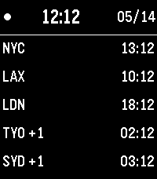

<!-- Generated by scripts/update_app_directory.py: do not edit by hand -->
[← All Pebble Developers](../developers.md)

# David Macias

*1 watchface · Last updated 2026-10-12 · [About these lists](../about-app-lists.md)*

Links: [Pebble App Store](https://apps.repebble.com/apps/dev/david-macias_6a0607510685d800098aa265) · [GitHub (david-macias)](https://github.com/david-macias) · [Website (linkedin.com)](https://linkedin.com/in/dmacias)

<h2 class="app-name" id="app-6a06095a576d4f000996eb3e"><a href="https://apps.repebble.com/6a06095a576d4f000996eb3e">Multi Timezone with Date</a> v1.0.7</h2>
<a class="app-source" href="https://github.com/david-macias/Multi-Timezone-with-Date-Pebble-Watchface/releases/download/v1.0.7/Multi.Timezone.with.Date.Pebble.Watchface.pbw" title="Source code" data-search-exclude>View source</a>

Watchface · <a href="https://forum.rebble.io/t/975" title="Discuss this app on the Rebble forum" data-search-exclude>Forum thread</a>

MIT Released 2026-05-14 Updated 2026-05-14

Runs on: Time 2, Pebble 2 Duo, Pebble 2, Time, Classic

A Pebble watchface by David Macias, inspired by World Watch by Seaware. Adds two small things on top of the original idea: - MM/DD date in the top-right corner of the header. - A +1 or -1 suffix…

