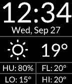
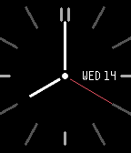
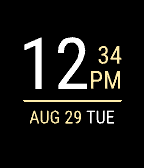
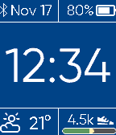
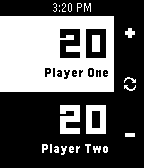

<!-- Generated by scripts/update_app_directory.py: do not edit by hand -->
[← All Pebble Developers](../developers.md)

# David Morgan

*12 watchfaces and 1 app · Last updated 2026-10-11 · [About these lists](../about-app-lists.md)*

Links: [Rebble App Store](https://apps.rebble.io/en_US/developer/564924e14f9b2989ec000014/1) · [Pebble App Store](https://apps.repebble.com/apps/dev/david-morgan_564924e14f9b2989ec000014) · [GitHub (Spitemare)](https://github.com/Spitemare)

<button type="button" data-filter="all" aria-pressed="true">All 13</button><button type="button" data-filter="watchface" aria-pressed="false">Watchfaces 12</button><button type="button" data-filter="watchapp" aria-pressed="false">Apps 1</button>

<label class="dev-sort">Sort by <select><option value="updated">Recently updated</option><option value="released">Newest release</option><option value="title">A–Z</option></select></label>

<h2 class="app-name" id="app-5a3acf170dfc32dba00014d2"><a href="https://apps.rebble.io/en_US/application/5a3acf170dfc32dba00014d2">Nasty Woman</a> v1.0</h2>
<a class="app-source" href="https://github.com/Spitemare/nasty-woman" title="Source code" data-search-exclude>View source</a>

Watchface

ISC Released 2017-12-20 Updated 2017-12-20 Rebble App Store

Runs on: Round 2, Time 2, Pebble 2 Duo, Pebble 2, Time Round, Time, Classic

Such a nasty woman.

<h2 class="app-name" id="app-59cba0830dfc32af6100388b"><a href="https://apps.rebble.io/en_US/application/59cba0830dfc32af6100388b">CaseFace</a> v1.4</h2>
<a class="app-source" href="https://github.com/Spitemare/case-face" title="Source code" data-search-exclude>View source</a>

Watchface

MIT Released 2017-09-27 Updated 2017-12-14 Rebble App Store

Runs on: Time 2, Pebble 2 Duo, Pebble 2, Time, Classic

Inspired by a design from /u/offu in the Pebble subreddit. A clean design putting time and weather upfront. Four bottom quadrants can be configured to show all sorts of information: - Battery…

<h2 class="app-name" id="app-59a6e780461a8d0b77001590"><a href="https://apps.rebble.io/en_US/application/59a6e780461a8d0b77001590">Grace</a> v1.6</h2>
<a class="app-source" href="https://github.com/Spitemare/grace" title="Source code" data-search-exclude>View source</a>

Watchface

MIT Released 2017-08-30 Updated 2017-09-07 Rebble App Store

Runs on: Round 2, Time 2, Pebble 2 Duo, Pebble 2, Time Round, Time, Classic

Based on a design by /u/maqtanim on the Pebble subreddit. Grace is elegance simplified. Current temperature is also available via Yahoo!, OpenWeatherMap, Weather Underground, or Dark Sky. Master…

<h2 class="app-name" id="app-59a5967c461a8d34f6001568"><a href="https://apps.rebble.io/en_US/application/59a5967c461a8d34f6001568">maqtanim</a> v1.0</h2>
<a class="app-source" href="https://github.com/Spitemare/maqtanim" title="Source code" data-search-exclude>View source</a>

Watchface

MIT Released 2017-08-29 Updated 2017-08-29 Rebble App Store

Runs on: Round 2, Time 2, Pebble 2 Duo, Pebble 2, Time Round, Time, Classic

Based on a design by /u/maqtanim on the Pebble subreddit.

<h2 class="app-name" id="app-5845d2e6ca30949f470007cd"><a href="https://apps.rebble.io/en_US/application/5845d2e6ca30949f470007cd">Constructor</a> v1.8</h2>
<a class="app-source" href="https://github.com/Spitemare/constructor" title="Source code" data-search-exclude>View source</a>

Watchface

MIT Released 2016-12-05 Updated 2017-06-09 Rebble App Store

Runs on: Round 2, Time 2, Pebble 2 Duo, Pebble 2, Time Round, Time, Classic

Every wanted to customize a watchface in real time? Now you can! Every element can be stretched, rotated, moved, and recolored. Changes are sent to the watch instantly so you can customize in real…

<h2 class="app-name" id="app-58c837ba6ca38730e9000954"><a href="https://apps.rebble.io/en_US/application/58c837ba6ca38730e9000954">Tapestry</a> v1.0</h2>
<a class="app-source" href="https://github.com/Spitemare/tapestry" title="Source code" data-search-exclude>View source</a>

Watchface

MIT Released 2017-03-14 Updated 2017-03-14 Rebble App Store

Runs on: Round 2, Time 2, Pebble 2 Duo, Pebble 2, Time Round, Time, Classic

Inspired by a design by /u/LlemonPls at reddit. Tapestry is a simple yet elegant watchface with a banner motif. Shake for battery and connection info. Settings: - Background and banner color …

<h2 class="app-name" id="app-57c73bc35e3c3de356000034"><a href="https://apps.repebble.com/57c73bc35e3c3de356000034">Workaday</a> v2.2</h2>
<a class="app-source" href="https://github.com/Spitemare/workaday" title="Source code" data-search-exclude>View source</a>

Watchface

MIT Released 2016-08-31 Updated 2017-03-09

Runs on: Time 2, Pebble 2 Duo, Pebble 2, Time, Classic

Workaday is a simple and functional watchface. It includes all the complications you would expect: * Date * Time * Battery level * Connection indicator * Weather * Step count Workaday strives to…

<h2 class="app-name" id="app-5873df118006df065c000104"><a href="https://apps.rebble.io/en_US/application/5873df118006df065c000104">On the Edge</a> v1.0</h2>
<a class="app-source" href="https://github.com/Spitemare/ote" title="Source code" data-search-exclude>View source</a>

Watchface

MIT Released 2017-01-09 Updated 2017-01-09 Rebble App Store

Runs on: Round 2, Time 2, Pebble 2 Duo, Pebble 2, Time Round, Time, Classic

A simple analog watchface that sets the hour ticks on the edge of the screen. Current hour is highlighted. When Bluetooth connection is lost center circle changes size. Features: - Configurable…

<h2 class="app-name" id="app-5835c47a00355aeb3d000013"><a href="https://apps.repebble.com/5835c47a00355aeb3d000013">Slice</a> v1.2</h2>
<a class="app-source" href="https://github.com/Spitemare/slice" title="Source code" data-search-exclude>View source</a>

Watchface

ISC Released 2016-11-23 Updated 2016-11-25

Runs on: Round 2, Time 2, Pebble 2 Duo, Pebble 2, Time Round, Time, Classic

Something made at the request of /u/Yohemies on reddit.com Minute hand color is configurable.

<h2 class="app-name" id="app-5810e678d0050280b10000e9"><a href="https://apps.repebble.com/5810e678d0050280b10000e9">That&#x27;s No Moon</a> v1.0</h2>
<a class="app-source" href="https://github.com/Spitemare/tnm" title="Source code" data-search-exclude>View source</a>

Watchface

ISC Released 2016-10-26 Updated 2016-10-26

Runs on: Round 2, Time 2, Pebble 2 Duo, Pebble 2, Time Round, Time, Classic

...it&#x27;s a watchface. TNM displays the time in a unique, rotary fashion. It&#x27;s reminiscent of a famous, fully armed and operational battle station. Outer ring is minutes. Middle ring is hour. Inner…

<h2 class="app-name" id="app-56808c7c54f8d36ac50000e9"><a href="https://apps.repebble.com/56808c7c54f8d36ac50000e9">Lifelink</a> v2.1</h2>
<a class="app-source" href="https://github.com/Spitemare/lifelink" title="Source code" data-search-exclude>View source</a>

App

No licence Released 2015-12-28 Updated 2016-09-01

Runs on: Round 2, Time 2, Pebble 2 Duo, Pebble 2, Time Round, Time, Classic

Lifelink is a simple life counter for Magic: the Gathering. Press the select button to swap between players. Up and down buttons add and subtract life. Double press the select button to reset life…

<h2 class="app-name" id="app-57b32777bb85ed1b790000a4"><a href="https://apps.repebble.com/57b32777bb85ed1b790000a4">Polarity</a> v1.0</h2>
<a class="app-source" href="https://github.com/Spitemare/polarity" title="Source code" data-search-exclude>View source</a>

Watchface

ISC Released 2016-08-16 Updated 2016-08-16

Runs on: Round 2, Time 2, Pebble 2 Duo, Pebble 2, Time Round, Time, Classic

Yet another polar watchface. Building off of Concentricity, Polarity adds configurable colors, step count, and battery level. To read the watchface, start with the outer ring: * Minutes * Hours *…

<h2 class="app-name" id="app-571132cf46e6404f36000007"><a href="https://apps.repebble.com/571132cf46e6404f36000007">Well Rounded</a> v1.2</h2>
<a class="app-source" href="https://github.com/Spitemare/well-rounded" title="Source code" data-search-exclude>View source</a>

Watchface

MIT Released 2016-04-15 Updated 2016-04-19

Runs on: Round 2, Time 2, Pebble 2 Duo, Pebble 2, Time Round, Time, Classic

Make it yours! Well Rounded is an analog watchface with lots of configuration. Colors, ticks, second hand, complications. Want to know your battery level? Inner ring. Want to see if how your daily…

