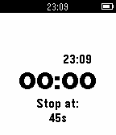

<!-- Generated by scripts/update_app_directory.py: do not edit by hand -->
[← All Pebble Developers](../developers.md)

# David Padilla

*1 app · Last updated 2026-10-11 · [About these lists](../about-app-lists.md)*

Links: [Pebble App Store](https://apps.repebble.com/apps/dev/david-padilla_52f084b03fbdba0ccb001df8) · [GitHub (dabit)](https://github.com/dabit)

<h2 class="app-name" id="app-5615bbe67e6126a558000042"><a href="https://apps.repebble.com/5615bbe67e6126a558000042">GymSpotter</a> v1.9</h2>
<a class="app-source" href="https://github.com/dabit/gymspotter" title="Source code" data-search-exclude>View source</a>

App

Released 2015-10-08 Updated 2015-12-31

Runs on: Round 2, Time 2, Pebble 2 Duo, Pebble 2, Time Round, Time, Classic

Timer app that helps you manage rest time between sets. Set your preferred rest time and when you are done with your shake the watch a bit and let the timer begin. When the timer is done your…

