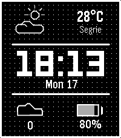
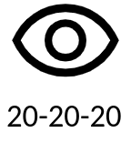
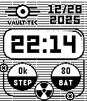
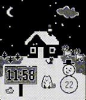

<!-- Generated by scripts/update_app_directory.py: do not edit by hand -->
[← All Pebble Developers](../developers.md)

# David Peer

*4 watchfaces and 2 apps · Last updated 2026-10-12 · [About these lists](../about-app-lists.md)*

Links: [Pebble App Store](https://apps.repebble.com/apps/dev/david-peer_68fb6df5d3c6e4000885b8f5) · [GitHub (peerdavid)](https://github.com/peerdavid) · [Website (paypal.com)](https://www.paypal.com/donate/?hosted_button_id=Y4PDJU84LC3N2)

<button type="button" data-filter="all" aria-pressed="true">All 6</button><button type="button" data-filter="watchface" aria-pressed="false">Watchfaces 4</button><button type="button" data-filter="watchapp" aria-pressed="false">Apps 2</button>

<label class="dev-sort">Sort by <select><option value="updated">Recently updated</option><option value="released">Newest release</option><option value="title">A–Z</option></select></label>

<h2 class="app-name" id="app-20546b1dc76e4eb0aa4cbc1f"><a href="https://apps.repebble.com/20546b1dc76e4eb0aa4cbc1f">Pebble Mesh</a> v1.66</h2>
<a class="app-source" href="https://github.com/peerdavid/pebble-mesh" title="Source code" data-search-exclude>View source</a>

Watchface · <a href="https://forum.rebble.io/t/592" title="Discuss this app on the Rebble forum" data-search-exclude>Forum thread</a>

Released 2026-02-28 Updated 2026-09-02

Runs on: Time 2, Pebble 2 Duo, Pebble 2, Time

Pebble Mesh is an open-source, retro-digital watch face designed for maximum clarity and essential stats. This face features a signature dot-matrix grid background that gives it a crisp…

<h2 class="app-name" id="app-6914c16e66ee0d00098fecd5"><a href="https://apps.repebble.com/6914c16e66ee0d00098fecd5">Eye Protect (20-20-20)</a> v1.0.1</h2>
<a class="app-source" href="https://github.com/peerdavid/pebble-20-20-20" title="Source code" data-search-exclude>View source</a>

App · <a href="https://forum.rebble.io/t/1256" title="Discuss this app on the Rebble forum" data-search-exclude>Forum thread</a>

Released 2025-11-12 Updated 2026-08-20

Runs on: Time 2, Pebble 2 Duo, Pebble 2, Time, Classic

Staring at screens all day? Give your eyes the break they desperately need with the 20-20-20 rule! This simple and essential app automatically reminds you about the recommended 20-20-20 rule. How…

<h2 class="app-name" id="app-d824a71853744a26b726ffb1"><a href="https://apps.repebble.com/d824a71853744a26b726ffb1">NestedNumbers</a> v2.22</h2>
<a class="app-source" href="https://github.com/peerdavid/pebble-nested-numbers" title="Source code" data-search-exclude>View source</a>

Watchface · <a href="https://forum.rebble.io/t/213" title="Discuss this app on the Rebble forum" data-search-exclude>Forum thread</a>

Released 2026-03-21 Updated 2026-03-23

Runs on: Time 2, Pebble 2 Duo, Pebble 2, Time, Classic

A simple watch face with large numbers. The numbers are nested so always read from left to right and inside to the outside. It also implements a menu that you can circle with flick (double flöick…

<h2 class="app-name" id="app-2fe5ba2363c042e89553c33e"><a href="https://apps.repebble.com/2fe5ba2363c042e89553c33e">LibreHealth</a> v1.0</h2>
<a class="app-source" href="https://github.com/peerdavid/pebble-libre-health" title="Source code" data-search-exclude>View source</a>

App · <a href="https://forum.rebble.io/t/772" title="Discuss this app on the Rebble forum" data-search-exclude>Forum thread</a>

Released 2026-03-15 Updated 2026-03-15

Runs on: Round 2, Time 2, Pebble 2 Duo, Pebble 2, Time Round, Time, Classic

# Libre Health Companion Pebble companion app for Libre Health, the open-source, local-only health tracker for Android. Warning: Requires the LibreHealth Android companion app. Automatically syncs…

<h2 class="app-name" id="app-6951762424ba4b0009dc92c5"><a href="https://apps.repebble.com/6951762424ba4b0009dc92c5">Vault</a> v1.3</h2>
<a class="app-source" href="https://github.com/peerdavid/pebble-vault" title="Source code" data-search-exclude>View source</a>

Watchface · <a href="https://forum.rebble.io/t/366" title="Discuss this app on the Rebble forum" data-search-exclude>Forum thread</a>

Released 2025-12-28 Updated 2025-12-28

Runs on: Time 2, Pebble 2 Duo, Pebble 2, Time, Classic

A fallout inspired open-source watch face which shows the date, time as well as the number of steps and the battery level. Disclaimer: This project is an open-source, fan-made creation and is not…

<h2 class="app-name" id="app-69218c65f5dd27000979ece0"><a href="https://apps.repebble.com/69218c65f5dd27000979ece0">Winter</a> v1.2</h2>
<a class="app-source" href="https://github.com/peerdavid/pebble-winter/" title="Source code" data-search-exclude>View source</a>

Watchface

Released 2025-11-22 Updated 2025-11-27

Runs on: Time 2, Pebble 2 Duo, Pebble 2, Time, Classic

An open-source watchface for the winter and christmas season inlcuding animations for snowflakes and a smoking chimne. And, of couse, I included some cute cats and rabbits. Flick to trigger the…

