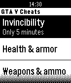

<!-- Generated by scripts/update_app_directory.py: do not edit by hand -->
[← All Pebble Developers](../developers.md)

# David Román

*1 app · Last updated 2026-10-12 · [About these lists](../about-app-lists.md)*

Links: [Pebble App Store](https://apps.repebble.com/apps/dev/david-rom-n_52da738b227cbe316c000106) · [GitHub (Dromaguirre)](https://github.com/Dromaguirre)

<h2 class="app-name" id="app-52da8d31227cbe9cb800012c"><a href="https://apps.repebble.com/52da8d31227cbe9cb800012c">GTA V Cheats</a> v1.0</h2>
<a class="app-source" href="http://github.com/Dromaguirre/GTAVCheatsForPebble" title="Source code" data-search-exclude>View source</a>

App

No licence Released 2014-01-18 Updated 2014-01-18

Runs on: Time 2, Pebble 2 Duo, Pebble 2, Time, Classic

A really simple watchapp that allows you to quickly access any GTA V cheat (PS3).

