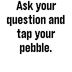

<!-- Generated by scripts/update_app_directory.py: do not edit by hand -->
[← All Pebble Developers](../developers.md)

# David Ryan

*1 app · Last updated 2026-10-12 · [About these lists](../about-app-lists.md)*

Links: [Pebble App Store](https://apps.repebble.com/apps/dev/david-ryan_52f0647ca0cb6af44f001749) · [GitHub (ptcryan)](https://github.com/ptcryan)

<h2 class="app-name" id="app-5346b35474eafce75b000334"><a href="https://apps.repebble.com/5346b35474eafce75b000334">Pebble 8 Ball</a> v1.0.0</h2>
<a class="app-source" href="https://github.com/ptcryan/pebble8ball" title="Source code" data-search-exclude>View source</a>

App

Released 2014-04-10 Updated 2014-04-10

Runs on: Time 2, Pebble 2 Duo, Pebble 2, Time, Classic

A pebble rendition of the classic magic 8 ball game.

