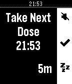

<!-- Generated by scripts/update_app_directory.py: do not edit by hand -->
[← All Pebble Developers](../developers.md)

# david.s.svedberg@gmail.com

*2 apps · Last updated 2026-10-11 · [About these lists](../about-app-lists.md)*

Links: [Rebble App Store](https://apps.rebble.io/en_US/developer/610fffcb1342ae019adb509e/1) · [GitHub (david-s-svedberg)](https://github.com/david-s-svedberg)

<button type="button" data-filter="all" aria-pressed="true">All 2</button><button type="button" data-filter="watchface" aria-pressed="false" disabled>Watchfaces 0</button><button type="button" data-filter="watchapp" aria-pressed="false">Apps 2</button>

<label class="dev-sort">Sort by <select><option value="updated">Recently updated</option><option value="released">Newest release</option><option value="title">A–Z</option></select></label>

<h2 class="app-name" id="app-62572dfbf13e3000e1c60301"><a href="https://apps.rebble.io/en_US/application/62572dfbf13e3000e1c60301">Wean</a> v1.0</h2>
<a class="app-source" href="https://github.com/david-s-svedberg/pebble-nicotine" title="Source code" data-search-exclude>View source</a>

App

Released 2022-04-13 Updated 2022-04-13 Rebble App Store

Runs on: Time 2, Pebble 2 Duo, Pebble 2, Time, Classic

Nicotine is an alarm app for spacing out (and hopefully decreasing) the intake of nicotine or other substances.

<h2 class="app-name" id="app-610fffcc1342ae019adb50a0"><a href="https://apps.rebble.io/en_US/application/610fffcc1342ae019adb50a0">Meds</a> v1.3</h2>
<a class="app-source" href="https://github.com/david-s-svedberg/pebble-medicine" title="Source code" data-search-exclude>View source</a>

App

Released 2021-08-08 Updated 2022-04-13 Rebble App Store

Runs on: Time 2, Pebble 2 Duo, Pebble 2, Time, Classic

Simple app to get reminders to take your medicine

