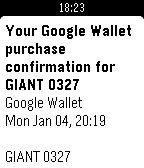

<!-- Generated by scripts/update_app_directory.py: do not edit by hand -->
[← All Pebble Developers](../developers.md)

# David Schneider

*1 app · Last updated 2026-10-11 · [About these lists](../about-app-lists.md)*

Links: [Pebble App Store](https://apps.repebble.com/apps/dev/david-schneider_5571d089a5c273c80500004e) · [GitHub (dnschneid)](https://github.com/dnschneid)

<h2 class="app-name" id="app-5691bdb1f72963ac6500001a"><a href="https://apps.repebble.com/5691bdb1f72963ac6500001a">Email for Pebble</a> v1.1</h2>
<a class="app-source" href="https://github.com/dnschneid/pebblegmail" title="Source code" data-search-exclude>View source</a>

App

Released 2016-01-10 Updated 2016-08-26

Runs on: Round 2, Time 2, Pebble 2 Duo, Pebble 2, Time Round, Time, Classic

Read email on your wrist! Email for Pebble lets you access your Gmail accounts without having to dig out your phone.

