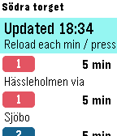

<!-- Generated by scripts/update_app_directory.py: do not edit by hand -->
[← All Pebble Developers](../developers.md)

# David Svantesson

*1 app · Last updated 2026-10-11 · [About these lists](../about-app-lists.md)*

Links: [Pebble App Store](https://apps.repebble.com/apps/dev/david-svantesson_5568880cc10547910a000026) · [GitHub (davidsvantesson)](https://github.com/davidsvantesson)

<h2 class="app-name" id="app-55eb169809fc08b14a000034"><a href="https://apps.repebble.com/55eb169809fc08b14a000034">VastTid</a> v1.0</h2>
<a class="app-source" href="https://github.com/davidsvantesson/VastTid" title="Source code" data-search-exclude>View source</a>

App

Released 2015-09-05 Updated 2015-09-05

Runs on: Time 2, Time

Public Transport app for West Sweden transport system (Västtrafik), showing the next departures (bus, tram, train and boats) in real time from the selected stop. The app uses the phones gps…

