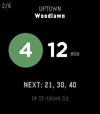

<!-- Generated by scripts/update_app_directory.py: do not edit by hand -->
[← All Pebble Developers](../developers.md)

# David Torcivia

*1 app · Last updated 2026-10-12 · [About these lists](../about-app-lists.md)*

Links: [Pebble App Store](https://apps.repebble.com/apps/dev/david-torcivia_29bff781261c3a32c5b9f900) · [GitHub (davidtorcivia)](https://github.com/davidtorcivia)

<h2 class="app-name" id="app-bf3aa4e4c7bd4ce5ad8b9392"><a href="https://apps.repebble.com/bf3aa4e4c7bd4ce5ad8b9392">Transit Arrivals</a> v1.14</h2>
<a class="app-source" href="https://github.com/davidtorcivia/transit-arrivals" title="Source code" data-search-exclude>View source</a>

App

MIT Released 2026-05-30 Updated 2026-09-16

Runs on: Round 2, Time 2, Pebble 2 Duo, Pebble 2, Time Round, Time

You&#x27;re three blocks from the platform. Do you run? MTA Arrivals answers the only question that matters to the new yorker on the go: how long until the next train. Pin your stations (Home, Work…

