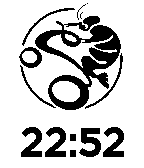

<!-- Generated by scripts/update_app_directory.py: do not edit by hand -->
[← All Pebble Developers](../developers.md)

# David Wang

*1 watchface · Last updated 2026-10-11 · [About these lists](../about-app-lists.md)*

Links: [Pebble App Store](https://apps.repebble.com/apps/dev/david-wang_541248e2715369243200000c) · [GitHub (david0932)](https://github.com/david0932) · [Website (david0932.blogspot.tw)](http://david0932.blogspot.tw/2014/09/the-first-pebble-watch-program.html)

<h2 class="app-name" id="app-5419a9ecd7eda443fb0001dd"><a href="https://apps.repebble.com/5419a9ecd7eda443fb0001dd">Scampi Watch</a> v1.0</h2>
<a class="app-source" href="https://github.com/david0932/MyPebbleFace/blob/master/main.c" title="Source code" data-search-exclude>View source</a>

Watchface

Released 2014-09-17 Updated 2014-09-17

Runs on: Time 2, Pebble 2 Duo, Pebble 2, Time, Classic

This is a bike team mark.

