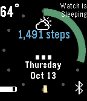

<!-- Generated by scripts/update_app_directory.py: do not edit by hand -->
[← All Pebble Developers](../developers.md)

# David Watson

*2 watchfaces · Last updated 2026-10-12 · [About these lists](../about-app-lists.md)*

Links: [Pebble App Store](https://apps.repebble.com/apps/dev/david-watson_564ba91d0fa9d91476000004) · [GitHub (ddwatson)](https://github.com/ddwatson) · [Website (sites.google.com)](https://sites.google.com/site/pebblelcars/)

<button type="button" data-filter="all" aria-pressed="true">All 2</button><button type="button" data-filter="watchface" aria-pressed="false">Watchfaces 2</button><button type="button" data-filter="watchapp" aria-pressed="false" disabled>Apps 0</button>

<label class="dev-sort">Sort by <select><option value="updated">Recently updated</option><option value="released">Newest release</option><option value="title">A–Z</option></select></label>

<h2 class="app-name" id="app-57efaa5605e4b118850001a6"><a href="https://apps.repebble.com/57efaa5605e4b118850001a6">Step in Time</a> v1.7</h2>
<a class="app-source" href="https://github.com/ddwatson/Step_in_Time" title="Source code" data-search-exclude>View source</a>

Watchface

Unlicense Released 2016-10-01 Updated 2017-06-05

Runs on: Time 2, Time

All: Idle and Sleep are fixed and obey the settings as I replaced the builtin app_timer functionality. This watchface is a reconstruction of the Strider watchface with some additional custom…

<h2 class="app-name" id="app-57adf202bb85edbc76000241"><a href="https://apps.repebble.com/57adf202bb85edbc76000241">NCC-1701D LCARS v1</a> v2.4</h2>
<a class="app-source" href="https://github.com/ddwatson/Pebble1701LCARS" title="Source code" data-search-exclude>View source</a>

Watchface

MIT Released 2016-08-12 Updated 2017-05-17

Runs on: Time 2, Time

Everyone: Idle and Sleep are now fixed and respond to the settings The captain has assigned the task of implementing an effective display for his wrist based ship status device, it has been many…

