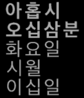

<!-- Generated by scripts/update_app_directory.py: do not edit by hand -->
[← All Pebble Developers](../developers.md)

# David Wen

*1 watchface · Last updated 2026-10-12 · [About these lists](../about-app-lists.md)*

Links: [Pebble App Store](https://apps.repebble.com/apps/dev/david-wen_538caa144a22b572c30000b3) · [GitHub (Dawenster)](https://github.com/Dawenster)

<h2 class="app-name" id="app-56267426c7810a62a100007d"><a href="https://apps.repebble.com/56267426c7810a62a100007d">Korean Watchface</a> v1.3</h2>
<a class="app-source" href="https://github.com/Dawenster/korean_watchface" title="Source code" data-search-exclude>View source</a>

Watchface

No licence Released 2015-10-20 Updated 2016-08-05

Runs on: Time 2, Pebble 2 Duo, Pebble 2, Time, Classic

Korean watchface on a dark background. Hour, minutes, day of week, month, and day of month. Time in bold. Useful for learning Korean or just telling the time in Korean!

