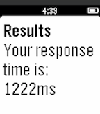

<!-- Generated by scripts/update_app_directory.py: do not edit by hand -->
[← All Pebble Developers](../developers.md)

# David Zhang

*1 app · Last updated 2026-10-11 · [About these lists](../about-app-lists.md)*

Links: [Pebble App Store](https://apps.repebble.com/apps/dev/david-zhang_558a4e13fb51551e4b000050) · [GitHub (davidozhang)](https://github.com/davidozhang)

<h2 class="app-name" id="app-562eca98a3c514c92a00001b"><a href="https://apps.repebble.com/562eca98a3c514c92a00001b">React</a> v1.1</h2>
<a class="app-source" href="https://github.com/davidozhang/pebblereact" title="Source code" data-search-exclude>View source</a>

App

Released 2015-10-27 Updated 2015-10-28

Runs on: Time 2, Pebble 2 Duo, Pebble 2, Time, Classic

Test your reaction time with this simple reaction-testing app!

