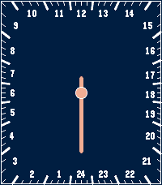
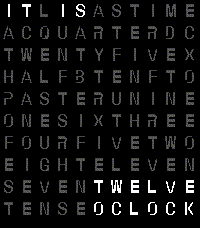
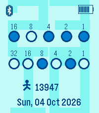

<!-- Generated by scripts/update_app_directory.py: do not edit by hand -->
[← All Pebble Developers](../developers.md)

# Davide Dell&\#x27;Erba

*4 watchfaces · Last updated 2026-10-11 · [About these lists](../about-app-lists.md)*

Links: [Pebble App Store](https://apps.repebble.com/apps/dev/davide-dell-erba_54c90ccd8359ae297b000054) · [GitHub (delda)](https://github.com/delda)

<button type="button" data-filter="all" aria-pressed="true">All 4</button><button type="button" data-filter="watchface" aria-pressed="false">Watchfaces 4</button><button type="button" data-filter="watchapp" aria-pressed="false" disabled>Apps 0</button>

<label class="dev-sort">Sort by <select><option value="updated">Recently updated</option><option value="released">Newest release</option><option value="title">A–Z</option></select></label>

<h2 class="app-name" id="app-4f27b20d89244f2d8f0ca9d5"><a href="https://apps.repebble.com/4f27b20d89244f2d8f0ca9d5">DotLine</a> v1.1.0</h2>
<a class="app-source" href="https://github.com/delda/pebble-picto" title="Source code" data-search-exclude>View source</a>

Watchface

Released 2026-10-02 Updated 2026-10-09

Runs on: Round 2, Time Round

It is a watch with a dot and a line: the dot indicates the hours and the line the minutes. Nothing could be simpler, nothing could be more functional!

<h2 class="app-name" id="app-d1c1ab1801e745f3a894690a"><a href="https://apps.repebble.com/d1c1ab1801e745f3a894690a">Slow Watch</a> v1.5.0</h2>
<a class="app-source" href="https://github.com/delda/pebble-slowatch" title="Source code" data-search-exclude>View source</a>

Watchface

Released 2026-09-01 Updated 2026-10-08

Runs on: Round 2, Time 2, Pebble 2 Duo, Pebble 2, Time Round, Time, Classic

Slow Watch is a calm, single-hand 24-hour watchface for Pebble. Instead of circling the dial twice a day, its copper hand completes one full rotation every 24 hours. The navy dial is numbered…

<h2 class="app-name" id="app-b77f1449d5a84104a86fba6d"><a href="https://apps.repebble.com/b77f1449d5a84104a86fba6d">Word Clock</a> v1.3.7</h2>
<a class="app-source" href="https://github.com/delda/pebble-qlocktwo" title="Source code" data-search-exclude>View source</a>

Watchface

Released 2026-08-14 Updated 2026-10-06

Runs on: Time 2, Pebble 2 Duo, Pebble 2, Time, Classic

Instead of showing digits, it displays the time in words by illuminating words within a grid of letters. It’s a modern and stylish clock. Personalise your watchface directly from the settings: …

<h2 class="app-name" id="app-5502d67eaab67c67a50000c6"><a href="https://apps.repebble.com/5502d67eaab67c67a50000c6">Binary Watch</a> v4.5.0</h2>
<a class="app-source" href="https://github.com/delda/pebble-BinaryWatchFace" title="Source code" data-search-exclude>View source</a>

Watchface

Released 2015-03-13 Updated 2026-10-05

Runs on: Round 2, Time 2, Pebble 2 Duo, Pebble 2, Time Round, Time, Classic

A binary clock is a clock that displays the time in a binary format. The first row is for hours, the second for minutes. Configurable options: - Colors palette - Different shapes for dots …

