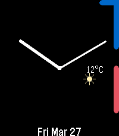

<!-- Generated by scripts/update_app_directory.py: do not edit by hand -->
[← All Pebble Developers](../developers.md)

# davv47

*1 watchface and 1 app · Last updated 2026-10-12 · [About these lists](../about-app-lists.md)*

Links: [Pebble App Store](https://apps.repebble.com/apps/dev/davv47_1e99e01092773fbbf3fc696c) · [GitHub (davv47)](https://github.com/davv47)

<button type="button" data-filter="all" aria-pressed="true">All 2</button><button type="button" data-filter="watchface" aria-pressed="false">Watchfaces 1</button><button type="button" data-filter="watchapp" aria-pressed="false">Apps 1</button>

<label class="dev-sort">Sort by <select><option value="updated">Recently updated</option><option value="released">Newest release</option><option value="title">A–Z</option></select></label>

<h2 class="app-name" id="app-b229dc1d5c514592b970629b"><a href="https://apps.repebble.com/b229dc1d5c514592b970629b">Dancing Dino</a> v1.0</h2>
<a class="app-source" href="https://github.com/davv47/Pebble_Dino_Dance" title="Source code" data-search-exclude>View source</a>

App

No licence Released 2026-04-08 Updated 2026-04-08

Runs on: Round 2, Time 2, Pebble 2 Duo, Pebble 2, Time Round, Time, Classic

Dancing dino app (mostly made for my toddler).

<h2 class="app-name" id="app-7aa753337cf04ec89830e08b"><a href="https://apps.repebble.com/7aa753337cf04ec89830e08b">Analogue Time Arc</a> v1.3</h2>
<a class="app-source" href="https://github.com/davv47/Analogue_Time_Arc" title="Source code" data-search-exclude>View source</a>

Watchface

No licence Released 2026-03-27 Updated 2026-04-08

Runs on: Round 2, Time 2, Time Round, Time

Watchface that shows public event event calendars in an arc on the perimeter of the screen. Notes: - This only works on public calendar feeds (at the moment). You can create public calendar feeds…

