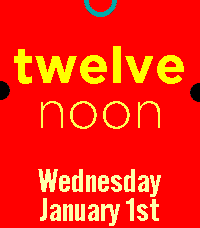

<!-- Generated by scripts/update_app_directory.py: do not edit by hand -->
[← All Pebble Developers](../developers.md)

# DC

*1 watchface · Last updated 2026-10-12 · [About these lists](../about-app-lists.md)*

Links: [Pebble App Store](https://apps.repebble.com/apps/dev/dc_531cd26a46b8f200dd000450) · [GitHub (wackyneighbor)](https://github.com/wackyneighbor) · [Website (wackyneighbor.github.io)](https://wackyneighbor.github.io/DC_Text_Watch_Deluxe/config.html?ColorScheme=1&SinglePrefixType=2&Enlarge=True&RectTimeAlign=5&RectDateAlign=2&NoGPS=0&BackgroundColor1=FFFFAA&TextLine1Color1=550055&TextLine2Color1=AA5500&TextLine3Color1=55AA00&TextDayColor1=FF0055&TextDateColor1=FF0055&TimeIndicatorColor1=55AA00&SunriseIndicatorColor1=AA5555&SunsetIndicatorColor1=AA5555&BackgroundColor2=000000&TextLine1Color2=AA5500&TextLine2Color2=AA5500&TextLine3Color2=AA5500&TextDayColor2=FFFF55&TextDateColor2=FFFFAA&TimeIndicatorColor2=FFAA00&SunriseIndicatorColor2=555500&SunsetIndicatorColor2=555500&BackgroundColor3=FF0000&TextLine1Color3=FFFF00&TextLine2Color3=FFFF55&TextLine3Color3=FFFF55&TextDayColor3=FFFFAA&TextDateColor3=FFFFAA&TimeIndicatorColor3=00AAAA&SunriseIndicatorColor3=000000&SunsetIndicatorColor3=000000&return_to=https%3A//cloudpebble.repebble.com/ide/emulator/config%3F)

<h2 class="app-name" id="app-56ab1cfe6ca919990000000e"><a href="https://apps.repebble.com/56ab1cfe6ca919990000000e">Text Watch Deluxe</a> v2.0.1</h2>
<a class="app-source" href="https://github.com/wackyneighbor/DC_Text_Watch_Deluxe" title="Source code" data-search-exclude>View source</a>

Watchface

Released 2016-01-29 Updated 2026-07-05

Runs on: Round 2, Time 2, Pebble 2 Duo, Pebble 2, Time Round, Time, Classic

Elegant, simple, and practical, this is a variant of Pebble&#x27;s original &quot;Sliding Text&quot; watchface, with some significant enhancements such as configurable colors, text justification options, and a…

