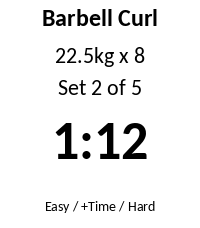

<!-- Generated by scripts/update_app_directory.py: do not edit by hand -->
[← All Pebble Developers](../developers.md)

# dcmcand

*1 app · Last updated 2026-10-11 · [About these lists](../about-app-lists.md)*

Links: [Pebble App Store](https://apps.repebble.com/apps/dev/dcmcand_e5d1645ced4da580ea8c0470) · [GitHub (dcmcand)](https://github.com/dcmcand)

<h2 class="app-name" id="app-e7478392e757413996a8edff"><a href="https://apps.repebble.com/e7478392e757413996a8edff">GymLog</a> v2.0.2</h2>
<a class="app-source" href="https://github.com/dcmcand/gymlog" title="Source code" data-search-exclude>View source</a>

App

Released 2026-07-12 Updated 2026-09-29

Runs on: Time 2

See your rest timer and current set on your wrist. Finish a set in the GymLog Android app and the watch shows the exercise, your target weight and reps, and which set you&#x27;re on, with a live rest…

