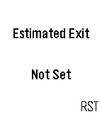

<!-- Generated by scripts/update_app_directory.py: do not edit by hand -->
[← All Pebble Developers](../developers.md)

# dega1999

*1 app · Last updated 2026-10-11 · [About these lists](../about-app-lists.md)*

Links: [Pebble App Store](https://apps.repebble.com/apps/dev/dega1999_55a35e2048928937d60000c6) · [GitHub (crazycoder1999)](https://github.com/crazycoder1999)

<h2 class="app-name" id="app-571ff77ac46a52b6e9000006"><a href="https://apps.repebble.com/571ff77ac46a52b6e9000006">WorkTime</a> v1.1</h2>
<a class="app-source" href="https://github.com/crazycoder1999/worktime" title="Source code" data-search-exclude>View source</a>

App

Released 2016-04-26 Updated 2016-06-26

Runs on: Time 2, Time

Do you want to be alerted when you can leave the office? Just 3 screens and you are done! I did it in my spare time.. nothing professional, just for fun!

