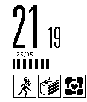
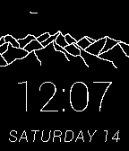

<!-- Generated by scripts/update_app_directory.py: do not edit by hand -->
[← All Pebble Developers](../developers.md)

# degygii

*3 watchfaces · Last updated 2026-10-12 · [About these lists](../about-app-lists.md)*

Links: [Pebble App Store](https://apps.repebble.com/apps/dev/degygii_5499d00473268f31cd000104) · [GitHub (degygii)](https://github.com/degygii)

<button type="button" data-filter="all" aria-pressed="true">All 3</button><button type="button" data-filter="watchface" aria-pressed="false">Watchfaces 3</button><button type="button" data-filter="watchapp" aria-pressed="false" disabled>Apps 0</button>

<label class="dev-sort">Sort by <select><option value="updated">Recently updated</option><option value="released">Newest release</option><option value="title">A–Z</option></select></label>

<h2 class="app-name" id="app-556382a65c83e51dbb000091"><a href="https://apps.repebble.com/556382a65c83e51dbb000091">Portal Sign</a> v1.1</h2>
<a class="app-source" href="https://github.com/degygii/portal_watchface" title="Source code" data-search-exclude>View source</a>

Watchface

MIT Released 2015-05-25 Updated 2015-05-25

Runs on: Time 2, Pebble 2 Duo, Pebble 2, Time, Classic

A Portal themed Watchface, made to look like the posters in the beginning of the level. It displays time, date and the remaining charge as the progress graph. The face contains twenty tiles which…

<h2 class="app-name" id="app-54df3ccc91a09e4790000087"><a href="https://apps.repebble.com/54df3ccc91a09e4790000087">Panoramic</a> v1.4</h2>
<a class="app-source" href="https://github.com/degygii/Panoramic" title="Source code" data-search-exclude>View source</a>

Watchface

MIT Released 2015-02-14 Updated 2015-02-18

Runs on: Time 2, Pebble 2 Duo, Pebble 2, Time, Classic

A mountain inspired watchface If you want a version without the seconds animation, check out my other watchface, Panoramic lite. A beautiful (imho) and functional watchface, showing a panoramic…

<h2 class="app-name" id="app-54b7a043cba63609af000041"><a href="https://apps.repebble.com/54b7a043cba63609af000041">Grid Code</a> v1.2</h2>
<a class="app-source" href="https://github.com/degygii/gridcode" title="Source code" data-search-exclude>View source</a>

Watchface

No licence Released 2015-01-15 Updated 2015-02-08

Runs on: Time 2, Pebble 2 Duo, Pebble 2, Time, Classic

Modified Version of the Grid Lite Watchface by Pebble Technology, with a different, lighter typeface.

