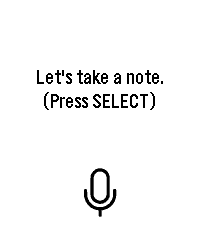

<!-- Generated by scripts/update_app_directory.py: do not edit by hand -->
[← All Pebble Developers](../developers.md)

# Delta-43

*1 app · Last updated 2026-10-11 · [About these lists](../about-app-lists.md)*

Links: [Pebble App Store](https://apps.repebble.com/apps/dev/delta-43_e215a5ae13b465e6441eafe6) · [GitHub (Delta-43)](https://github.com/Delta-43)

<h2 class="app-name" id="app-c2c541a7bc004712894f8d46"><a href="https://apps.repebble.com/c2c541a7bc004712894f8d46">Delta Notes</a> v1.0.0</h2>
<a class="app-source" href="https://github.com/Delta-43/pebble-watch-obsidian-notes" title="Source code" data-search-exclude>View source</a>

App

AGPL-3.0 Released 2026-09-10 Updated 2026-09-10

Runs on: Round 2, Time 2, Pebble 2 Duo, Pebble 2, Time Round, Time

Dictate a note on your wrist and have it saved straight into your own self-hosted Obsidian vault. Requires your own n8n instance — not a standalone note-taking app. Delta Notes turns your Pebble…

