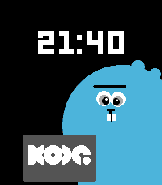
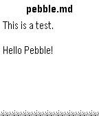

<!-- Generated by scripts/update_app_directory.py: do not edit by hand -->
[← All Pebble Developers](../developers.md)

# Dennis Muensterer

*2 watchfaces and 1 app · Last updated 2026-10-11 · [About these lists](../about-app-lists.md)*

Links: [Pebble App Store](https://apps.repebble.com/apps/dev/dennis-muensterer_53cc9927fd8ebf394ae021ca) · [GitHub (dnnsmnstrr)](https://github.com/dnnsmnstrr) · [Website (kode.diy)](https://kode.diy/)

<button type="button" data-filter="all" aria-pressed="true">All 3</button><button type="button" data-filter="watchface" aria-pressed="false">Watchfaces 2</button><button type="button" data-filter="watchapp" aria-pressed="false">Apps 1</button>

<label class="dev-sort">Sort by <select><option value="updated">Recently updated</option><option value="released">Newest release</option><option value="title">A–Z</option></select></label>

<h2 class="app-name" id="app-0b8f41cdbba6456298c9821a"><a href="https://apps.repebble.com/0b8f41cdbba6456298c9821a">Kode Dot</a> v1.0.1</h2>
<a class="app-source" href="https://github.com/dnnsmnstrr/kode-dot-watchface" title="Source code" data-search-exclude>View source</a>

Watchface

Released 2026-07-15 Updated 2026-07-15

Runs on: Round 2, Time 2, Pebble 2 Duo, Pebble 2, Time Round, Time, Classic

Wear the new mascot for Kode Dot on your wrist while waiting for the actual device

<h2 class="app-name" id="app-276ed3773d8548c09b372204"><a href="https://apps.repebble.com/276ed3773d8548c09b372204">Flipper Zero</a> v1.1.1</h2>
<a class="app-source" href="https://github.com/dnnsmnstrr/pebble-flipper" title="Source code" data-search-exclude>View source</a>

Watchface

Released 2026-07-02 Updated 2026-07-07

Runs on: Round 2, Time 2, Pebble 2 Duo, Pebble 2, Time Round, Time, Classic

A Flipper on your wrist

<h2 class="app-name" id="app-9b0dacec26c041f688e85e78"><a href="https://apps.repebble.com/9b0dacec26c041f688e85e78">Gist Reader</a> v1.1</h2>
<a class="app-source" href="https://github.com/dnnsmnstrr/pebble-gist-reader" title="Source code" data-search-exclude>View source</a>

App

Released 2026-04-18 Updated 2026-04-25

Runs on: Round 2, Time 2, Pebble 2 Duo, Pebble 2, Time Round, Time, Classic

Access GitHub Gists on your wrist! - Simple configuration with just a Gist ID - Support for multiple files in one Gist

