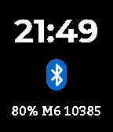

<!-- Generated by scripts/update_app_directory.py: do not edit by hand -->
[← All Pebble Developers](../developers.md)

# dentonlt

*1 watchface · Last updated 2026-10-12 · [About these lists](../about-app-lists.md)*

Links: [Rebble App Store](https://apps.rebble.io/en_US/developer/5e1409743dd3108e69a17716/1) · [GitHub (dentonlt)](https://github.com/dentonlt) · [Website (dentonlt.com)](https://www.dentonlt.com)

<h2 class="app-name" id="app-5e1409743dd3108e69a17718"><a href="https://apps.rebble.io/en_US/application/5e1409743dd3108e69a17718">Etude 4</a> v0.8</h2>
<a class="app-source" href="https://github.com/dentonlt/pebble-etude4" title="Source code" data-search-exclude>View source</a>

Watchface

GPL-3.0 Released 2020-01-07 Updated 2020-04-10 Rebble App Store

Runs on: Round 2, Time 2, Pebble 2 Duo, Pebble 2, Time Round, Time, Classic

Etude 4 is a minimal, balanced watchface for Pebble/Rebble. The main time header is displayed in 12h/24h format according to the user&#x27;s system preferences. The background and text colors are…

