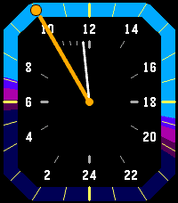
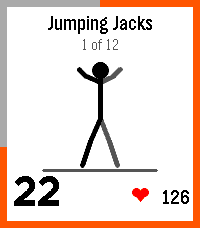

<!-- Generated by scripts/update_app_directory.py: do not edit by hand -->
[← All Pebble Developers](../developers.md)

# Derek Pomery

*1 watchface and 2 apps · Last updated 2026-10-12 · [About these lists](../about-app-lists.md)*

Links: [Pebble App Store](https://apps.repebble.com/apps/dev/derek-pomery_a3018d0553fce8ef213841de)

<button type="button" data-filter="all" aria-pressed="true">All 3</button><button type="button" data-filter="watchface" aria-pressed="false">Watchfaces 1</button><button type="button" data-filter="watchapp" aria-pressed="false">Apps 2</button>

<label class="dev-sort">Sort by <select><option value="updated">Recently updated</option><option value="released">Newest release</option><option value="title">A–Z</option></select></label>

<h2 class="app-name" id="app-7c57983c73d04247b5bfb6b7"><a href="https://apps.repebble.com/7c57983c73d04247b5bfb6b7">Solar 24</a> v1.5.2</h2>
<a class="app-source" href="https://m8y.org/pebble/" title="Source code" data-search-exclude>View source</a>

Watchface

Released 2026-09-29 Updated 2026-10-05

Runs on: Time 2, Pebble 2 Duo, Pebble 2

A 24h watch face with day/night/twilight segments customised to your location. Credits to Claude Opus 5.5 which did all the work, and to Steven Pomeroy for the concept described here …

<h2 class="app-name" id="app-6c3b99402ffd45569323b7aa"><a href="https://apps.repebble.com/6c3b99402ffd45569323b7aa">Notes+</a> v1.1.0</h2>
<a class="app-source" href="https://m8y.org/pebble/" title="Source code" data-search-exclude>View source</a>

App

Released 2026-10-05 Updated 2026-10-05

Runs on: Round 2, Time 2, Pebble 2 Duo, Pebble 2, Time Round, Time

Directly inspired by the Simple Notes app. It was just missing 2 features I really wanted. ① Ability to append to notes. ② (and this was the big one) getting the notes out of the watch so I could…

<h2 class="app-name" id="app-0ca00e938572442eb31cff74"><a href="https://apps.repebble.com/0ca00e938572442eb31cff74">7-Minute Workout</a> v1.8.0</h2>
<a class="app-source" href="https://m8y.org/pebble/" title="Source code" data-search-exclude>View source</a>

App

Released 2026-10-03 Updated 2026-10-03

Runs on: Round 2, Time 2, Pebble 2 Duo, Pebble 2, Time Round, Time, Classic

7-Minute Workout I wanted a Pebble version of my daily exercise. This is the well-known 12-exercise high-intensity circuit for the Pebble, courtesy of Claude Opus 5.5. Includes animations to show…

