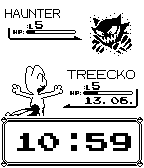

<!-- Generated by scripts/update_app_directory.py: do not edit by hand -->
[← All Pebble Developers](../developers.md)

# derfreimann

*2 watchfaces · Last updated 2026-10-12 · [About these lists](../about-app-lists.md)*

Links: [Pebble App Store](https://apps.repebble.com/apps/dev/derfreimann_52dea28d81cae24943000082) · [GitHub (derfreimann)](https://github.com/derfreimann) · [Website (forums.getpebble.com)](https://forums.getpebble.com/discussion/13508/watch-face-pokebattle-v3-0-available-now-fixed-all-crashing-issues-added-new-features)

<button type="button" data-filter="all" aria-pressed="true">All 2</button><button type="button" data-filter="watchface" aria-pressed="false">Watchfaces 2</button><button type="button" data-filter="watchapp" aria-pressed="false" disabled>Apps 0</button>

<label class="dev-sort">Sort by <select><option value="updated">Recently updated</option><option value="released">Newest release</option><option value="title">A–Z</option></select></label>

<h2 class="app-name" id="app-5390676b9e48a5d169000004"><a href="https://apps.repebble.com/5390676b9e48a5d169000004">PokeBattle</a> v3.3</h2>
<a class="app-source" href="https://github.com/derfreimann/pokebattle" title="Source code" data-search-exclude>View source</a>

Watchface

No licence Released 2014-06-05 Updated 2016-04-05

Runs on: Time 2, Pebble 2 Duo, Pebble 2, Time, Classic

Random battles, changing every hour! [30+ different Pokemons] ♥ guaranteed crash free :D - 12h&amp;24h mode - lower HP-bar = Pebble&#x27;s battery - SLP status while disconnected - level up with each…

<h2 class="app-name" id="app-5399622a798be93078000010"><a href="https://apps.repebble.com/5399622a798be93078000010">tiny doctors</a> v2.3</h2>
<a class="app-source" href="https://github.com/derfreimann/tinydoctors" title="Source code" data-search-exclude>View source</a>

Watchface

No licence Released 2014-06-12 Updated 2014-09-22

Runs on: Time 2, Pebble 2 Duo, Pebble 2, Time, Classic

Features cute, miniature versions of your favorite Doctor Who timelord! ✿ Update v2.3 [Sep.22] - added 1 monster, the burning T-Rex from Ep01S08 (=64 monsters in total) please visit WEBSITE for…

