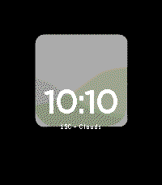

<!-- Generated by scripts/update_app_directory.py: do not edit by hand -->
[← All Pebble Developers](../developers.md)

# designerferro

*2 watchfaces · Last updated 2026-10-12 · [About these lists](../about-app-lists.md)*

Links: [Pebble App Store](https://apps.repebble.com/apps/dev/designerferro_53c71908165754dfa700004b) · [GitHub (designerferro)](https://github.com/designerferro) · [Website (pouparmelhor.com)](http://www.pouparmelhor.com/)

<button type="button" data-filter="all" aria-pressed="true">All 2</button><button type="button" data-filter="watchface" aria-pressed="false">Watchfaces 2</button><button type="button" data-filter="watchapp" aria-pressed="false" disabled>Apps 0</button>

<label class="dev-sort">Sort by <select><option value="updated">Recently updated</option><option value="released">Newest release</option><option value="title">A–Z</option></select></label>

<h2 class="app-name" id="app-21e81244431f4889a7211035"><a href="https://apps.repebble.com/21e81244431f4889a7211035">hugenumbers</a> v1.0.4</h2>
<a class="app-source" href="https://github.com/designerferro/hugenumbers" title="Source code" data-search-exclude>View source</a>

Watchface

No licence Released 2026-10-05 Updated 2026-10-05

Runs on: Round 2, Time 2, Pebble 2 Duo, Pebble 2, Time Round, Time, Classic

A Flux-inspired Pebble watchface with oversized, independently deformed HH/MM numerals and a rising seconds colour field. This is an original implementation using open-source fonts, not Apple&#x27;s…

<h2 class="app-name" id="app-56a3b156eaa02c6a87000033"><a href="https://apps.repebble.com/56a3b156eaa02c6a87000033">PouparMelhor.com</a> v1.1</h2>
<a class="app-source" href="https://github.com/designerferro/PouparMelhor-pebble-face" title="Source code" data-search-exclude>View source</a>

Watchface

GPL-3.0 Released 2016-01-23 Updated 2026-04-12

Runs on: Round 2, Time 2, Pebble 2 Duo, Pebble 2, Time Round, Time, Classic

This is a watchface for our site PouparMelhor.com. It&#x27;s just an adaptation of the Developer tutorials into some logo from our site for now. Still needs some polishing on the new bigger screens…

