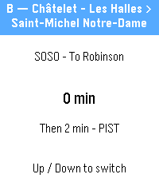

<!-- Generated by scripts/update_app_directory.py: do not edit by hand -->
[← All Pebble Developers](../developers.md)

# DestCom - StroyCo

*1 app · Last updated 2026-11-09 · [About these lists](../about-app-lists.md)*

Links: [Pebble App Store](https://apps.repebble.com/apps/dev/destcom-stroyco_2203050ae984342dfa2814f5) · [GitHub (DestroyCom)](https://github.com/DestroyCom)

<h2 class="app-name" id="app-861a9def83ad417d89eee4cd"><a href="https://apps.repebble.com/861a9def83ad417d89eee4cd">StroyCommute - Paris metro, RER &amp; tram times</a> v1.0.0</h2>
<a class="app-source" href="https://github.com/DestroyCom/StroyCommute" title="Source code" data-search-exclude>View source</a>

App

GPL-3.0 Released 2026-10-16 Updated 2026-10-16

Runs on: Time 2

Real-time next departures for Paris / Île-de-France public transport, right on your wrist. • Metro, tram, RER and Transilien, with the official line colors. • Next departure plus the following…

