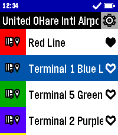
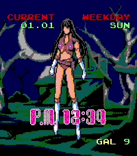

<!-- Generated by scripts/update_app_directory.py: do not edit by hand -->
[← All Pebble Developers](../developers.md)

# DEVELARPER

*2 watchfaces and 1 app · Last updated 2026-10-12 · [About these lists](../about-app-lists.md)*

Links: [Pebble App Store](https://apps.repebble.com/apps/dev/develarper_3e9db43ff8d760635172598e) · [GitHub (GuruGitHubTheG)](https://github.com/GuruGitHubTheG)

<button type="button" data-filter="all" aria-pressed="true">All 3</button><button type="button" data-filter="watchface" aria-pressed="false">Watchfaces 2</button><button type="button" data-filter="watchapp" aria-pressed="false">Apps 1</button>

<label class="dev-sort">Sort by <select><option value="updated">Recently updated</option><option value="released">Newest release</option><option value="title">A–Z</option></select></label>

<h2 class="app-name" id="app-8d5a983845754bd0b3c8ac68"><a href="https://apps.repebble.com/8d5a983845754bd0b3c8ac68">TransLoc</a> v1.0.0</h2>
<a class="app-source" href="https://github.com/GuruGitHubTheG/TransLoc-Pebble" title="Source code" data-search-exclude>View source</a>

App

No licence Released 2026-10-05 Updated 2026-10-05

Runs on: Time 2, Pebble 2 Duo, Pebble 2, Time

Catch the bus in style with TransLoc for Pebble! With support for over one hundred transit agencies, this app can get you where you need to go. Don&#x27;t second guess when your bus will arrive, find…

<h2 class="app-name" id="app-de6ae671c22b4fe7aa72b57b"><a href="https://apps.repebble.com/de6ae671c22b4fe7aa72b57b">OneShot: The World Machine</a> v2.1.2</h2>
<a class="app-source" href="https://github.com/GuruGitHubTheG/TWM" title="Source code" data-search-exclude>View source</a>

Watchface

No licence Released 2026-08-22 Updated 2026-10-05

Runs on: Round 2, Time 2, Pebble 2 Duo, Pebble 2, Time Round, Time, Classic

Tell the time. But remember, You only have One Shot. View the time with a strange computer operating system, The World Machine. It has the same additions that OneShot: World Machine Edition…

<h2 class="app-name" id="app-ceed895304554825b295d32a"><a href="https://apps.repebble.com/ceed895304554825b295d32a">TIMEGAL</a> v3.2.0</h2>
<a class="app-source" href="https://github.com/GuruGitHubTheG/TIMEGAL" title="Source code" data-search-exclude>View source</a>

Watchface

No licence Released 2026-07-12 Updated 2026-09-06

Runs on: Round 2, Time 2, Pebble 2 Duo, Pebble 2, Time Round, Time, Classic

Enjoy a new appreciation for Taito&#x27;s 1985 classic, TIMEGAL! Have Reika spawn on your watch screen at customizable intervals! This watchface utilizes both the SEGA/MEGA-CD and arcade graphics, and…

