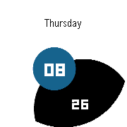
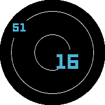
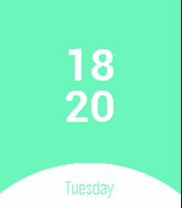

<!-- Generated by scripts/update_app_directory.py: do not edit by hand -->
[← All Pebble Developers](../developers.md)

# 佐伯楽

*4 watchfaces · Last updated 2026-10-12 · [About these lists](../about-app-lists.md)*

Links: [Rebble App Store](https://apps.rebble.io/en_US/developer/57df171b4fac5c6d30000005/1) · [GitHub (SaekiRaku)](https://github.com/SaekiRaku) · [Website (saekiraku.github.io)](https://saekiraku.github.io)

<button type="button" data-filter="all" aria-pressed="true">All 4</button><button type="button" data-filter="watchface" aria-pressed="false">Watchfaces 4</button><button type="button" data-filter="watchapp" aria-pressed="false" disabled>Apps 0</button>

<label class="dev-sort">Sort by <select><option value="updated">Recently updated</option><option value="released">Newest release</option><option value="title">A–Z</option></select></label>

<h2 class="app-name" id="app-598bbf7d0dfc322fe0000c42"><a href="https://apps.rebble.io/en_US/application/598bbf7d0dfc322fe0000c42">Round</a> v1.0</h2>
<a class="app-source" href="https://github.com/SaekiRaku/pebble-round" title="Source code" data-search-exclude>View source</a>

Watchface

MIT Released 2017-08-10 Updated 2017-08-10 Rebble App Store

Runs on: Round 2, Time Round

A simple watch face, hope you&#x27;d like it. The black &amp; colorful circle is mean minutes and hours. (I&#x27;m not good at English, you can just pass the Description ;-)

<h2 class="app-name" id="app-594a34140dfc32b63e00135b"><a href="https://apps.rebble.io/en_US/application/594a34140dfc32b63e00135b">Planet</a> v1.0</h2>
<a class="app-source" href="https://github.com/SaekiRaku/pebble-planet" title="Source code" data-search-exclude>View source</a>

Watchface

No licence Released 2017-06-21 Updated 2017-06-21 Rebble App Store

Runs on: Round 2, Time Round

A simple watchface, hope you like it.

<h2 class="app-name" id="app-5948f3320dfc32acc700004a"><a href="https://apps.rebble.io/en_US/application/5948f3320dfc32acc700004a">Cake</a> v1.2</h2>
<a class="app-source" href="https://github.com/SaekiRaku/pebble-cake" title="Source code" data-search-exclude>View source</a>

Watchface

No licence Released 2017-06-20 Updated 2017-06-21 Rebble App Store

Runs on: Round 2, Time 2, Time Round, Time

A cute watchface that supports multiple language. And opensource.

<h2 class="app-name" id="app-594880c90dfc327a610012af"><a href="https://apps.rebble.io/en_US/application/594880c90dfc327a610012af">Stars</a> v1.0</h2>
<a class="app-source" href="https://github.com/SaekiRaku/pebble-stars" title="Source code" data-search-exclude>View source</a>

Watchface

No licence Released 2017-06-20 Updated 2017-06-20 Rebble App Store

Runs on: Round 2, Time Round

A simulation of stars and the random stars will move at every second. 模拟星空的轨迹，随机出现的繁星每秒运动一次。

