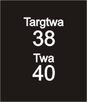

<!-- Generated by scripts/update_app_directory.py: do not edit by hand -->
[← All Pebble Developers](../developers.md)

# 

*1 app · Last updated 2026-10-11 · [About these lists](../about-app-lists.md)*

Links: [Rebble App Store](https://apps.rebble.io/en_US/developer/57c051b15e3c3d64fe000173/1) · [Website (ventusnavigation.com)](https://www.ventusnavigation.com)

<h2 class="app-name" id="app-57c055a05e3c3db485000173"><a href="https://apps.rebble.io/en_US/application/57c055a05e3c3db485000173">Ventus</a> v1.0</h2>
<a class="app-source" href="http://www.ventusnavigation.com/Pebble.html" title="Source code" data-search-exclude>View source</a>

App

Released 2016-08-26 Updated 2016-08-26 Rebble App Store

Runs on: Time 2, Pebble 2 Duo, Pebble 2, Time, Classic

Pebble Ventus displays navigation data on your Pebble watch received from either Android Ventus PRO or iOS Ventus PRO.

