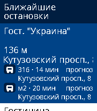

<!-- Generated by scripts/update_app_directory.py: do not edit by hand -->
[← All Pebble Developers](../developers.md)

# Грищенков Георгий

*1 app · Last updated 2026-11-16 · [About these lists](../about-app-lists.md)*

Links: [Pebble App Store](https://apps.repebble.com/apps/dev/developer_49172e30a71f25472cafe03a) · [GitHub (G0-G4)](https://github.com/G0-G4)

<h2 class="app-name" id="app-fb57a29ae6bb4b9a810085ba"><a href="https://apps.repebble.com/fb57a29ae6bb4b9a810085ba">WatchBus</a> v1.5.0</h2>
<a class="app-source" href="https://github.com/G0-G4/WatchBus" title="Source code" data-search-exclude>View source</a>

App

No licence Released 2026-11-13 Updated 2026-11-16

Runs on: Round 2, Time 2, Pebble 2 Duo, Time Round, Time

WatchBus показывает ближайшие остановки наземного транспорта Москвы и время прибытия автобусов, электробусов и трамваев. Остановки отсортированы по расстоянию. Подсказка о следующей остановке…

