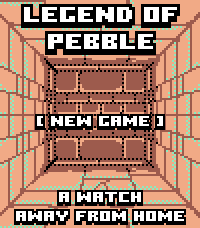

<!-- Generated by scripts/update_app_directory.py: do not edit by hand -->
[← All Pebble Developers](../developers.md)

# Devfootclan

*1 app · Last updated 2026-10-11 · [About these lists](../about-app-lists.md)*

Links: [Pebble App Store](https://apps.repebble.com/apps/dev/devfootclan_9e60866ea641e9284c6367a9) · [GitHub (damocamo)](https://github.com/damocamo) · [Website (ko-fi.com)](https://ko-fi.com/footclan)

<h2 class="app-name" id="app-402da10688d6443aa4a9a751"><a href="https://apps.repebble.com/402da10688d6443aa4a9a751">Legend of Pebble</a> v3.5.0</h2>
<a class="app-source" href="https://github.com/damocamo/ledged-of-pebble-" title="Source code" data-search-exclude>View source</a>

App

Released 2026-07-09 Updated 2026-09-13

Runs on: Round 2, Time 2

LEGEND OF PEBBLE A first-person dungeon crawler RPG for your wrist. THE STORY You check the time. The watch flares. The world twists. You wake in a rift ruled by the Signal Keepers. Ten floors…

