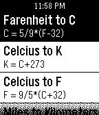

<!-- Generated by scripts/update_app_directory.py: do not edit by hand -->
[← All Pebble Developers](../developers.md)

# Devin Simmons

*2 apps · Last updated 2026-10-12 · [About these lists](../about-app-lists.md)*

Links: [Pebble App Store](https://apps.repebble.com/apps/dev/devin-simmons_52d70618af37946a7b000001) · [GitHub (blackpaw78)](https://github.com/blackpaw78)

<button type="button" data-filter="all" aria-pressed="true">All 2</button><button type="button" data-filter="watchface" aria-pressed="false" disabled>Watchfaces 0</button><button type="button" data-filter="watchapp" aria-pressed="false">Apps 2</button>

<label class="dev-sort">Sort by <select><option value="updated">Recently updated</option><option value="released">Newest release</option><option value="title">A–Z</option></select></label>

<h2 class="app-name" id="app-52efed1b4ae3636d4c00000d"><a href="https://apps.repebble.com/52efed1b4ae3636d4c00000d">PebbleFormulas Portuguese</a> v1.1.8</h2>
<a class="app-source" href="https://github.com/blackpaw78/PebbleFormulasPortuguese" title="Source code" data-search-exclude>View source</a>

App

No licence Released 2014-02-03 Updated 2014-02-03

Runs on: Time 2, Pebble 2 Duo, Pebble 2, Time, Classic

PebbleFormulas agora em portruguese! Uma maneira rápida conveniente de acessar muitas fórmulas para álgebra, geometria, trigonometria, cálculo, Biologia, Física, Química, conversões e…

<h2 class="app-name" id="app-52d714aaaf3794159d000006"><a href="https://apps.repebble.com/52d714aaaf3794159d000006">PebbleFormulas</a> v1.1.8</h2>
<a class="app-source" href="https://github.com/blackpaw78/PebbleFormulas" title="Source code" data-search-exclude>View source</a>

App

Unlicense Released 2014-01-15 Updated 2014-02-03

Runs on: Time 2, Pebble 2 Duo, Pebble 2, Time, Classic

A quick convenient way to access many formulas for Algebra, Geometry, Trigonometry, Calculus, Biology, Chemistry, Physics, Electricity, and Conversions. Updates will be common, adding new…

