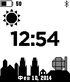
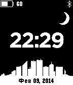

<!-- Generated by scripts/update_app_directory.py: do not edit by hand -->
[← All Pebble Developers](../developers.md)

# Dexif

*3 watchfaces · Last updated 2026-10-12 · [About these lists](../about-app-lists.md)*

Links: [Pebble App Store](https://apps.repebble.com/apps/dev/dexif_52cfaf52516669ee6b00003a) · [GitHub (dexif)](https://github.com/dexif) · [Website (spitsyn.net)](http://spitsyn.net)

<button type="button" data-filter="all" aria-pressed="true">All 3</button><button type="button" data-filter="watchface" aria-pressed="false">Watchfaces 3</button><button type="button" data-filter="watchapp" aria-pressed="false" disabled>Apps 0</button>

<label class="dev-sort">Sort by <select><option value="updated">Recently updated</option><option value="released">Newest release</option><option value="title">A–Z</option></select></label>

<h2 class="app-name" id="app-52f7fd2a14e54a5df20005a6"><a href="https://apps.repebble.com/52f7fd2a14e54a5df20005a6">Day/Night Minsk</a> v1.0.1</h2>
<a class="app-source" href="https://github.com/dexif/DayNightCity" title="Source code" data-search-exclude>View source</a>

Watchface

MIT Released 2014-02-09 Updated 2014-02-10

Runs on: Time 2, Pebble 2 Duo, Pebble 2, Time, Classic

At 6 am/pm starts Day/Night Minsk mode.

<h2 class="app-name" id="app-52f7e1067847556b4c0004dd"><a href="https://apps.repebble.com/52f7e1067847556b4c0004dd">Day/Night City</a> v1.0.1</h2>
<a class="app-source" href="https://github.com/dexif/DayNightCity" title="Source code" data-search-exclude>View source</a>

Watchface

MIT Released 2014-02-09 Updated 2014-02-10

Runs on: Time 2, Pebble 2 Duo, Pebble 2, Time, Classic

At 6 am/pm starts Day/Night mode.

<h2 class="app-name" id="app-52dc36aa75436b22120000f4"><a href="https://apps.repebble.com/52dc36aa75436b22120000f4">Pebblemous</a> v1.3</h2>
<a class="app-source" href="https://github.com/dexif/Pebblemous" title="Source code" data-search-exclude>View source</a>

Watchface

MIT Released 2014-01-19 Updated 2014-02-04

Runs on: Time 2, Pebble 2 Duo, Pebble 2, Time, Classic

Pebble Anonymous watchface

