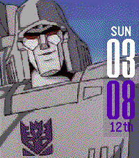
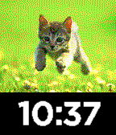

<!-- Generated by scripts/update_app_directory.py: do not edit by hand -->
[← All Pebble Developers](../developers.md)

# dezign999

*3 watchfaces · Last updated 2026-10-11 · [About these lists](../about-app-lists.md)*

Links: [Pebble App Store](https://apps.repebble.com/apps/dev/dezign999_52f03b26a0cb6a3454000dfb) · [GitHub (dezign999)](https://github.com/dezign999) · [GitHub (gregoiresage)](https://github.com/gregoiresage) · [Website (dezign999.com)](http://dezign999.com)

<button type="button" data-filter="all" aria-pressed="true">All 3</button><button type="button" data-filter="watchface" aria-pressed="false">Watchfaces 3</button><button type="button" data-filter="watchapp" aria-pressed="false" disabled>Apps 0</button>

<label class="dev-sort">Sort by <select><option value="updated">Recently updated</option><option value="released">Newest release</option><option value="title">A–Z</option></select></label>

<h2 class="app-name" id="app-7e1631e7a96f478f8a9810fc"><a href="https://apps.repebble.com/7e1631e7a96f478f8a9810fc">img999</a> v2.0</h2>
<a class="app-source" href="https://github.com/dezign999/img999" title="Source code" data-search-exclude>View source</a>

Watchface

Released 2026-04-12 Updated 2026-04-12

Runs on: Time 2, Pebble 2 Duo, Pebble 2, Time, Classic

Customizable watch face for Pebble Time, Pebble 2 and Pebble Classic which uses your own images. This uses resources from: Gregoiresage&#x27;s Image Viewer…

<h2 class="app-name" id="app-55b91f5cd01005e8c600007d"><a href="https://apps.repebble.com/55b91f5cd01005e8c600007d">imageWatch999</a> v1.0</h2>
<a class="app-source" href="https://github.com/gregoiresage/pebble-image-viewer" title="Source code" data-search-exclude>View source</a>

Watchface

Released 2015-07-29 Updated 2015-07-29

Runs on: Time 2, Time

#watchfacewednesday A simple watch face that will load your external jpg image onto your pebble. Use the settings page to add your image url, all image conversion is done on your phone for added…

<h2 class="app-name" id="app-557efe0f71b570913a00003a"><a href="https://apps.repebble.com/557efe0f71b570913a00003a">Pipe Dreams</a> v1.5</h2>
<a class="app-source" href="http://www.watchismo.com/mr-jones-sun-and-moon-miyamoto.aspx" title="Source code" data-search-exclude>View source</a>

Watchface

Released 2015-06-15 Updated 2015-06-15

Runs on: Time 2, Time

An analog watch face inspired by Mr. Jones Sun and Moon by Crispin Jones. The landscape gradually progresses throughout the day. Turns from day to night and back based on the current time. This is…

