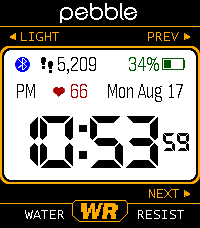

<!-- Generated by scripts/update_app_directory.py: do not edit by hand -->
[← All Pebble Developers](../developers.md)

# dflo

*1 watchface · Last updated 2026-10-12 · [About these lists](../about-app-lists.md)*

Links: [Pebble App Store](https://apps.repebble.com/apps/dev/dflo_b8221aa0c9a8dfb3f3a9ab91) · [Codeberg (dflo)](https://codeberg.org/dflo)

<h2 class="app-name" id="app-faedd501f8994eb3ba771475"><a href="https://apps.repebble.com/faedd501f8994eb3ba771475">91 Dub v5 plus</a> v6.0.21</h2>
<a class="app-source" href="https://codeberg.org/dflo/91-dub-v5-plus" title="Source code" data-search-exclude>View source</a>

Watchface

Released 2026-08-18 Updated 2026-09-17

Runs on: Time 2

91 Dub v5 plus A fork of 91 Dub v5 by lightrush[2] ( which is A fork of the great 91 Dub v4.0 watchface by Orviwan[1], rebuilt for the Pebble Time 2. ) Fully configurable colors New in v5 plus: …

