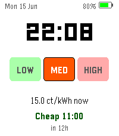
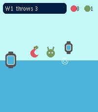
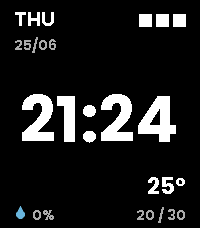
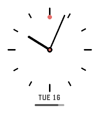
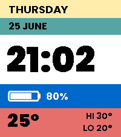

<!-- Generated by scripts/update_app_directory.py: do not edit by hand -->
[← All Pebble Developers](../developers.md)

# dhrme

*4 watchfaces and 2 apps · Last updated 2026-10-12 · [About these lists](../about-app-lists.md)*

Links: [Pebble App Store](https://apps.repebble.com/apps/dev/dhrme_069a96fda19388b2bd028bfa) · [GitHub (dhrme)](https://github.com/dhrme) · [GitHub (in-dhr)](https://github.com/in-dhr) · [Website (dhrme.nl)](https://dhrme.nl/apps)

<button type="button" data-filter="all" aria-pressed="true">All 6</button><button type="button" data-filter="watchface" aria-pressed="false">Watchfaces 4</button><button type="button" data-filter="watchapp" aria-pressed="false">Apps 2</button>

<label class="dev-sort">Sort by <select><option value="updated">Recently updated</option><option value="released">Newest release</option><option value="title">A–Z</option></select></label>

<h2 class="app-name" id="app-042ca18f3372422d9e07a406"><a href="https://apps.repebble.com/042ca18f3372422d9e07a406">Voice Notes (with calendar)</a> v1.1.2</h2>
<a class="app-source" href="https://github.com/dhrme/pebble-apps/tree/main" title="Source code" data-search-exclude>View source</a>

App

MIT Released 2026-06-17 Updated 2026-06-26

Runs on: Time 2

Speak a note, save a note, optionally get a calendar event. Dictate a quick note on your wrist and it lands in your Google Calendar — with the date and time parsed from what you said (&quot;call the…

<h2 class="app-name" id="app-db9ec6dac81d483cab5d616d"><a href="https://apps.repebble.com/db9ec6dac81d483cab5d616d">Dutch Energy Watchface</a> v1.3.0</h2>
<a class="app-source" href="https://github.com/in-dhr/pebble-apps" title="Source code" data-search-exclude>View source</a>

Watchface

No licence Released 2026-06-15 Updated 2026-06-26

Runs on: Time 2

Updates to watchface

<h2 class="app-name" id="app-84d17b57b0aa48ce8813659b"><a href="https://apps.repebble.com/84d17b57b0aa48ce8813659b">Pebble Throw</a> v1.0.0</h2>
<a class="app-source" href="https://github.com/dhrme/pebble-apps" title="Source code" data-search-exclude>View source</a>

App

MIT Released 2026-06-25 Updated 2026-06-25

Runs on: Time 2

The Pebble Throw rescues the world against evil fruit and robots. Ahem.

<h2 class="app-name" id="app-a4d962baee314d20819879fe"><a href="https://apps.repebble.com/a4d962baee314d20819879fe">Kevinimal</a> v1.1.0</h2>
<a class="app-source" href="https://github.com/dhrme/pebble-apps/tree/main/kevinimal" title="Source code" data-search-exclude>View source</a>

Watchface

MIT Released 2026-06-25 Updated 2026-06-25

Runs on: Time 2

A stripped-back watchface for Pebble Time 2. The time floats large in the centre; everything else tucks into a corner — day + DD/MM top-left, a three-block battery gauge top-right, chance-of-rain…

<h2 class="app-name" id="app-4ef760ca61cf4e2080edbd97"><a href="https://apps.repebble.com/4ef760ca61cf4e2080edbd97">Clean Atelier Watchface</a> v1.1.0</h2>
<a class="app-source" href="https://github.com/dhrme/pebble-apps/tree/main/atelier" title="Source code" data-search-exclude>View source</a>

Watchface

MIT Released 2026-06-17 Updated 2026-06-25

Runs on: Time 2

A clean analogue watchface by Rohan from DHRME

<h2 class="app-name" id="app-6da6ca00839f4cd7b982dd63"><a href="https://apps.repebble.com/6da6ca00839f4cd7b982dd63">Bold Bauhaus Blocks</a> v1.1.0</h2>
<a class="app-source" href="https://github.com/dhrme/pebble-apps/tree/main/blocks" title="Source code" data-search-exclude>View source</a>

Watchface

MIT Released 2026-06-25 Updated 2026-06-25

Runs on: Time 2

A bold, Bauhaus-inspired watchface for Pebble Time 2. Five flat colour bands stack the essentials: weekday, date, a big easy-read time, battery, and weather. Built for the watch&#x27;s crisp 64-colour…

