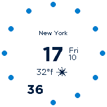
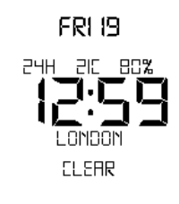
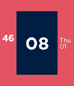

<!-- Generated by scripts/update_app_directory.py: do not edit by hand -->
[← All Pebble Developers](../developers.md)

# dieghernan

*4 watchfaces · Last updated 2026-10-12 · [About these lists](../about-app-lists.md)*

Links: [Rebble App Store](https://apps.rebble.io/en_US/developer/52f15b6dc41172eebc0004dc/1) · [GitHub (dieghernan)](https://github.com/dieghernan) · [Website (dieghernan.github.io)](https://dieghernan.github.io/Sfera/)

<button type="button" data-filter="all" aria-pressed="true">All 4</button><button type="button" data-filter="watchface" aria-pressed="false">Watchfaces 4</button><button type="button" data-filter="watchapp" aria-pressed="false" disabled>Apps 0</button>

<label class="dev-sort">Sort by <select><option value="updated">Recently updated</option><option value="released">Newest release</option><option value="title">A–Z</option></select></label>

<h2 class="app-name" id="app-58c2f7110dfc32a52a00081f"><a href="https://apps.rebble.io/en_US/application/58c2f7110dfc32a52a00081f">Sfera</a> v6.2</h2>
<a class="app-source" href="https://github.com/dieghernan/Sfera" title="Source code" data-search-exclude>View source</a>

Watchface

MIT Released 2017-03-10 Updated 2018-03-13 Rebble App Store

Runs on: Round 2, Time Round

* Consider ♥ if you enjoy this watchface * Sfera is a highly customizable watchface that gets the most of the smartwatch capabilities: Settings - Clock Mode: Analog / Digital /Dual/ Mix watchface…

<h2 class="app-name" id="app-591ead370dfc32aacf000204"><a href="https://apps.rebble.io/en_US/application/591ead370dfc32aacf000204">7egment</a> v1.3</h2>
<a class="app-source" href="https://github.com/dieghernan/7egment" title="Source code" data-search-exclude>View source</a>

Watchface

MIT Released 2017-05-19 Updated 2017-06-13 Rebble App Store

Runs on: Round 2, Time 2, Pebble 2 Duo, Pebble 2, Time Round, Time, Classic

7egment is a customizable watchface based on the classic 7-segment display that adds your location and the current weather information in the language used on your watch and smartphone. Features …

<h2 class="app-name" id="app-59280895b67f9f43f80004c9"><a href="https://apps.rebble.io/en_US/application/59280895b67f9f43f80004c9">Bzel</a> v3.1</h2>
<a class="app-source" href="https://github.com/dieghernan/Bzel" title="Source code" data-search-exclude>View source</a>

Watchface

MIT Released 2017-05-26 Updated 2017-06-12 Rebble App Store

Runs on: Round 2, Time 2, Pebble 2 Duo, Pebble 2, Time Round, Time, Classic

* Consider ♥ if you enjoy this watchface * Bzel integrates the watchface with your Bezel Settings - Clock Mode: Digital /Dot/ Bezel/ Arc / Line / Digidot /Blocks - Minute marks - Date …

<h2 class="app-name" id="app-58a94da90dfc32d35b0002f8"><a href="https://apps.rebble.io/en_US/application/58a94da90dfc32d35b0002f8">TextWatch Clima</a> v7.1</h2>
<a class="app-source" href="https://github.com/dieghernan/TextWatchClima" title="Source code" data-search-exclude>View source</a>

Watchface

No licence Released 2017-02-19 Updated 2017-05-25 Rebble App Store

Runs on: Round 2, Time 2, Pebble 2 Duo, Pebble 2, Time Round, Time, Classic

* Consider ♥ if you enjoy this watchface * Add some weather to your TextWatch! This watchface brings the weather conditions straight to your wrist. Multilingual -------- - Spanish - English …

