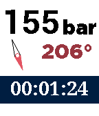

<!-- Generated by scripts/update_app_directory.py: do not edit by hand -->
[← All Pebble Developers](../developers.md)

# Diego Molla

*1 app · Last updated 2026-10-12 · [About these lists](../about-app-lists.md)*

Links: [Pebble App Store](https://apps.repebble.com/apps/dev/diego-molla_5531e08acb952be9ed0000ac) · [GitHub (dmollaaliod)](https://github.com/dmollaaliod)

<h2 class="app-name" id="app-557cde795f5eb8acdb0000b1"><a href="https://apps.repebble.com/557cde795f5eb8acdb0000b1">Scubawatch</a> v2.3</h2>
<a class="app-source" href="https://github.com/dmollaaliod/scubawatch" title="Source code" data-search-exclude>View source</a>

App

No licence Released 2015-06-14 Updated 2016-05-15

Runs on: Time 2, Pebble 2 Duo, Pebble 2, Time, Classic

A companion to scuba divers. This app can help you time your dives, and record your air consumption and compass heading. Simply press the up and down buttons to change the air pressure, and it…

