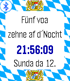

<!-- Generated by scripts/update_app_directory.py: do not edit by hand -->
[← All Pebble Developers](../developers.md)

# Dieter Meiller

*1 watchface · Last updated 2026-10-11 · [About these lists](../about-app-lists.md)*

Links: [Pebble App Store](https://apps.repebble.com/apps/dev/dieter-meiller_5596834a84bff5a34a000040) · [GitHub (oth-aw)](https://github.com/oth-aw)

<h2 class="app-name" id="app-55a2cb2c2965f266c4000062"><a href="https://apps.repebble.com/55a2cb2c2965f266c4000062">Bavarian Clock</a> v1.1</h2>
<a class="app-source" href="https://github.com/oth-aw/BavarianClock.git" title="Source code" data-search-exclude>View source</a>

Watchface

Released 2015-07-12 Updated 2015-07-13

Runs on: Time 2, Pebble 2 Duo, Pebble 2, Time, Classic

This watchface tells the time in the bavarian language (Bairisch).

