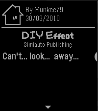

<!-- Generated by scripts/update_app_directory.py: do not edit by hand -->
[← All Pebble Developers](../developers.md)

# Difegue

*1 watchface and 1 app · Last updated 2026-10-12 · [About these lists](../about-app-lists.md)*

Links: [Pebble App Store](https://apps.repebble.com/apps/dev/difegue_59875ea00dfc321335000a40) · [GitHub (Difegue)](https://github.com/Difegue) · [Website (diy.tvc-16.science)](https://diy.tvc-16.science)

<button type="button" data-filter="all" aria-pressed="true">All 2</button><button type="button" data-filter="watchface" aria-pressed="false">Watchfaces 1</button><button type="button" data-filter="watchapp" aria-pressed="false">Apps 1</button>

<label class="dev-sort">Sort by <select><option value="updated">Recently updated</option><option value="released">Newest release</option><option value="title">A–Z</option></select></label>

<h2 class="app-name" id="app-2adaea94d1d0494fb015b4e8"><a href="https://apps.repebble.com/2adaea94d1d0494fb015b4e8">Yonderu! DoujinSoft</a> v1.2</h2>
<a class="app-source" href="https://github.com/Difegue/Yonderu-pebble" title="Source code" data-search-exclude>View source</a>

App · <a href="https://forum.rebble.io/t/930" title="Discuss this app on the Rebble forum" data-search-exclude>Forum thread</a>

GPL-3.0 Released 2026-04-16 Updated 2026-05-01

Runs on: Time 2, Pebble 2 Duo, Pebble 2, Time

A client for the DoujinSoft Store on Pebble, granting access to thousands of comics from the 2010 NDS game WarioWare DIY. Through the power of PebbleKit JS, get one curated B&amp;W 4-panel comic from…

<h2 class="app-name" id="app-637abd01fdf3e30009f6399c"><a href="https://apps.repebble.com/637abd01fdf3e30009f6399c">Copland</a> v2.3</h2>
<a class="app-source" href="https://github.com/Difegue/Copland" title="Source code" data-search-exclude>View source</a>

Watchface

MIT Released 2022-11-20 Updated 2025-03-07

Runs on: Round 2, Time 2, Pebble 2 Duo, Pebble 2, Time Round, Time, Classic

A quirky watchface with mid-90s sensibilities. Mix and match colorways and options to your liking! Inspired by https://www.hodinkee.com/articles/the-apple-watch-from-1995 .

