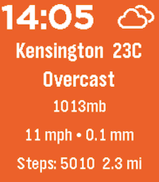
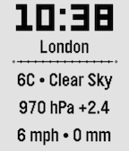

<!-- Generated by scripts/update_app_directory.py: do not edit by hand -->
[← All Pebble Developers](../developers.md)

# digitalurban

*2 watchfaces · Last updated 2026-10-12 · [About these lists](../about-app-lists.md)*

Links: [Rebble App Store](https://apps.rebble.io/en_US/developer/68e3f6cf0fd0b500086cea51/1) · [GitHub (digitalurban)](https://github.com/digitalurban) · [Website (digitalurban.org)](http://digitalurban.org)

<button type="button" data-filter="all" aria-pressed="true">All 2</button><button type="button" data-filter="watchface" aria-pressed="false">Watchfaces 2</button><button type="button" data-filter="watchapp" aria-pressed="false" disabled>Apps 0</button>

<label class="dev-sort">Sort by <select><option value="updated">Recently updated</option><option value="released">Newest release</option><option value="title">A–Z</option></select></label>

<h2 class="app-name" id="app-6aa2c3a676c8d6000a6e5057"><a href="https://apps.rebble.io/en_US/application/6aa2c3a676c8d6000a6e5057">Color Weather</a> v2.4.0</h2>
<a class="app-source" href="https://github.com/digitalurban/color-weather-pebble" title="Source code" data-search-exclude>View source</a>

Watchface

No licence Released 2026-09-10 Updated 2026-09-10 Rebble App Store

Runs on: Time 2

Color Weather delivers real-time weather, step tracking, and smart storm alerts to your wrist. Features background colors based on temperature, weather underground intergration for PWS data, storm…

<h2 class="app-name" id="app-69034d22d004720008412cf1"><a href="https://apps.rebble.io/en_US/application/69034d22d004720008412cf1">Just Weather</a> v3.4</h2>
<a class="app-source" href="https://github.com/digitalurban/just-weather-pebble-watchface" title="Source code" data-search-exclude>View source</a>

Watchface · <a href="https://forum.rebble.io/t/144" title="Discuss this app on the Rebble forum" data-search-exclude>Forum thread</a>

No licence Released 2025-10-30 Updated 2026-01-19 Rebble App Store

Runs on: Time 2, Pebble 2 Duo, Pebble 2, Time

Shows the Time, Location, Pressure (with Trend), Temperature, Conditions, Wind Gust and Rainfall amount from Open Meteo. Units can be configured, and it has an optional &#x27;Vibrate on the Hour&#x27;…

