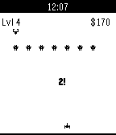

<!-- Generated by scripts/update_app_directory.py: do not edit by hand -->
[← All Pebble Developers](../developers.md)

# dijs

*1 app · Last updated 2026-10-12 · [About these lists](../about-app-lists.md)*

Links: [Pebble App Store](https://apps.repebble.com/apps/dev/dijs_5304f76ae3fb8e7bef0002bb) · [GitHub (dijs)](https://github.com/dijs) · [Website (richardvanderdys.com)](http://richardvanderdys.com/phoenix)

<h2 class="app-name" id="app-537ac468463ca3e5ae0000a7"><a href="https://apps.repebble.com/537ac468463ca3e5ae0000a7">Phoenix</a> v1.1.1</h2>
<a class="app-source" href="https://github.com/dijs/Phoenix" title="Source code" data-search-exclude>View source</a>

App

No licence Released 2014-05-20 Updated 2014-07-14

Runs on: Time 2, Pebble 2 Duo, Pebble 2, Time, Classic

Phoenix is a shoot-em-up game based in space. It includes never ending levels and a store where you can buy different guns and upgrades. Tilt your wrist to move the ship and destroy the enemies…

