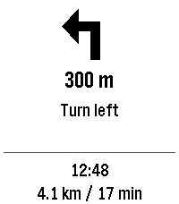

<!-- Generated by scripts/update_app_directory.py: do not edit by hand -->
[← All Pebble Developers](../developers.md)

# dimak21

*1 app · Last updated 2026-10-11 · [About these lists](../about-app-lists.md)*

Links: [Pebble App Store](https://apps.repebble.com/apps/dev/dimak21_5197d01875c2244ade01662d) · [GitHub (DimaK21)](https://github.com/DimaK21)

<h2 class="app-name" id="app-609c311158bd4a25a409a209"><a href="https://apps.repebble.com/609c311158bd4a25a409a209">YaNaviPeb</a> v0.3.0</h2>
<a class="app-source" href="https://github.com/DimaK21/YaNaviPeb" title="Source code" data-search-exclude>View source</a>

App

0BSD Released 2026-09-24 Updated 2026-09-24

Runs on: Round 2, Time 2, Pebble 2 Duo, Pebble 2, Time Round, Time, Classic

Turn-by-turn directions from Yandex Maps or Yandex Navigator on your Pebble watch. While you navigate, the watch shows the maneuver arrow, the distance to it, the maneuver text, your arrival time…

