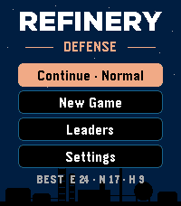
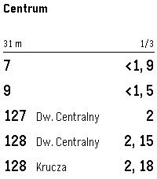
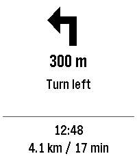

<!-- Generated by scripts/update_app_directory.py: do not edit by hand -->
[← All Pebble Developers](../developers.md)

# dimak21

*3 apps · Last updated 2026-11-02 · [About these lists](../about-app-lists.md)*

Links: [Pebble App Store](https://apps.repebble.com/apps/dev/dimak21_5197d01875c2244ade01662d) · [GitHub (DimaK21)](https://github.com/DimaK21)

<button type="button" data-filter="all" aria-pressed="true">All 3</button><button type="button" data-filter="watchface" aria-pressed="false" disabled>Watchfaces 0</button><button type="button" data-filter="watchapp" aria-pressed="false">Apps 3</button>

<label class="dev-sort">Sort by <select><option value="updated">Recently updated</option><option value="released">Newest release</option><option value="title">A–Z</option></select></label>

<h2 class="app-name" id="app-00a95540142a497d84db5240"><a href="https://apps.repebble.com/00a95540142a497d84db5240">Refinery Defense</a> v1.4.3</h2>
<a class="app-source" href="https://github.com/DimaK21/RefineryDefense" title="Source code" data-search-exclude>View source</a>

App

MIT Released 2026-10-20 Updated 2026-10-20

Runs on: Round 2, Time 2

Refinery Defense is an endless tower defense game made for touchscreen Pebble watches. BY DAY, build up your air defense. Tap the map to place MG nests, Gepard guns, Tor and Patriot missile…

<h2 class="app-name" id="app-ed5a5b30bd474f6fac31f634"><a href="https://apps.repebble.com/ed5a5b30bd474f6fac31f634">Ostanovka</a> v1.1.0</h2>
<a class="app-source" href="https://github.com/DimaK21/Ostanovka" title="Source code" data-search-exclude>View source</a>

App

Apache-2.0 Released 2026-10-17 Updated 2026-10-17

Runs on: Round 2, Time 2, Pebble 2 Duo, Pebble 2, Time Round, Time, Classic

Open Ostanovka and see when the next buses and trams arrive at the stop nearest to you, from live vehicle positions. Up and Down page through other stops nearby. Save up to 10 stops per city on…

<h2 class="app-name" id="app-609c311158bd4a25a409a209"><a href="https://apps.repebble.com/609c311158bd4a25a409a209">YaNaviPeb</a> v0.3.0</h2>
<a class="app-source" href="https://github.com/DimaK21/YaNaviPeb" title="Source code" data-search-exclude>View source</a>

App

0BSD Released 2026-09-24 Updated 2026-09-24

Runs on: Round 2, Time 2, Pebble 2 Duo, Pebble 2, Time Round, Time, Classic

Turn-by-turn directions from Yandex Maps or Yandex Navigator on your Pebble watch. While you navigate, the watch shows the maneuver arrow, the distance to it, the maneuver text, your arrival time…

