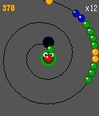
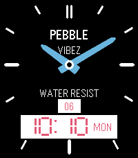

<!-- Generated by scripts/update_app_directory.py: do not edit by hand -->
[← All Pebble Developers](../developers.md)

# Dimitrios Vlachos

*1 watchface and 1 app · Last updated 2026-10-11 · [About these lists](../about-app-lists.md)*

Links: [Pebble App Store](https://apps.repebble.com/apps/dev/dimitrios-vlachos_296346ae8a735277a71ae4c6) · [GitHub (Mesa-LLC)](https://github.com/Mesa-LLC)

<button type="button" data-filter="all" aria-pressed="true">All 2</button><button type="button" data-filter="watchface" aria-pressed="false">Watchfaces 1</button><button type="button" data-filter="watchapp" aria-pressed="false">Apps 1</button>

<label class="dev-sort">Sort by <select><option value="updated">Recently updated</option><option value="released">Newest release</option><option value="title">A–Z</option></select></label>

<h2 class="app-name" id="app-0fbc95ed5419436185c7f0c5"><a href="https://apps.repebble.com/0fbc95ed5419436185c7f0c5">PebbLoop</a> v1.4</h2>
<a class="app-source" href="https://github.com/Mesa-LLC/PebbLoop/" title="Source code" data-search-exclude>View source</a>

App

Apache-2.0 Released 2026-04-03 Updated 2026-04-07

Runs on: Time 2, Time

Ever wished being able to play Zuma or Puzz Loop on your Pebble? Now you can! Survive as long as you can in this addictive and fast-paced ball-shooting game! Shoot balls of the same color to…

<h2 class="app-name" id="app-ccf3493e462a4b938b528cfc"><a href="https://apps.repebble.com/ccf3493e462a4b938b528cfc">Ana-Digi Pro</a> v4.4</h2>
<a class="app-source" href="https://github.com/Mesa-LLC/Ana-Digi-Pro" title="Source code" data-search-exclude>View source</a>

Watchface

Apache-2.0 Released 2026-03-30 Updated 2026-04-06

Runs on: Time 2, Pebble 2 Duo, Pebble 2, Time, Classic

Hybrid analogue-digital watchface Casio vibes for Pebble Classic and Pebble Steel. Combines virtual hands and dual LCD windows, all animating like an 80s sci-fi watch when returning to it. Sleek…

