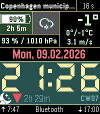

<!-- Generated by scripts/update_app_directory.py: do not edit by hand -->
[← All Pebble Developers](../developers.md)

# djda9l

*1 watchface · Last updated 2026-10-12 · [About these lists](../about-app-lists.md)*

Links: [Pebble App Store](https://apps.repebble.com/apps/dev/djda9l_cd32d7170b062d30c6545359) · [GitHub (PingPongLee)](https://github.com/PingPongLee)

<h2 class="app-name" id="app-24eb98026beb41acbc57b15b"><a href="https://apps.repebble.com/24eb98026beb41acbc57b15b">Multifunctional 7 Segment Reborn</a> v1.2.1</h2>
<a class="app-source" href="https://github.com/PingPongLee/pebble-mss" title="Source code" data-search-exclude>View source</a>

Watchface · <a href="https://forum.rebble.io/t/639" title="Discuss this app on the Rebble forum" data-search-exclude>Forum thread</a>

GPL-3.0 Released 2026-02-12 Updated 2026-10-11

Runs on: Round 2, Time 2, Pebble 2 Duo, Pebble 2, Time Round, Time, Classic

(NOTE: Still being tested, so bugs might occour) Based on the original Multifunctional 7 Segment watchface by FG. * Fixes config page * Upscaled graphics for Pebble Time 2 * New theme option, that…

