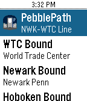

<!-- Generated by scripts/update_app_directory.py: do not edit by hand -->
[← All Pebble Developers](../developers.md)

# DLevine.us

*2 watchfaces and 1 app · Last updated 2026-10-12 · [About these lists](../about-app-lists.md)*

Links: [Rebble App Store](https://apps.rebble.io/en_US/developer/54106f95816f735f200001ba/1) · [GitHub (djlevine)](https://github.com/djlevine)

<button type="button" data-filter="all" aria-pressed="true">All 3</button><button type="button" data-filter="watchface" aria-pressed="false">Watchfaces 2</button><button type="button" data-filter="watchapp" aria-pressed="false">Apps 1</button>

<label class="dev-sort">Sort by <select><option value="updated">Recently updated</option><option value="released">Newest release</option><option value="title">A–Z</option></select></label>

<h2 class="app-name" id="app-5936d5e70dfc326f9c000ea5"><a href="https://apps.rebble.io/en_US/application/5936d5e70dfc326f9c000ea5">NYCTA Map Face</a> v1.2</h2>
<a class="app-source" href="https://github.com/djlevine/NYCTA_watchface" title="Source code" data-search-exclude>View source</a>

Watchface

No licence Released 2017-06-06 Updated 2017-08-02 Rebble App Store

Runs on: Round 2, Time 2, Pebble 2 Duo, Pebble 2, Time Round, Time, Classic

Watch face based on the Vignelli style NYC Subway map. - The 6th Avenue line (vertical lines) display the time - The Shuttle line (top horizontal) displays AM or PM Screenshot with back light on…

<h2 class="app-name" id="app-58dac0a90dfc32fe6000073f"><a href="https://apps.rebble.io/en_US/application/58dac0a90dfc32fe6000073f">NYCTime</a> v3.31</h2>
<a class="app-source" href="https://github.com/djlevine/NYCTimeColor" title="Source code" data-search-exclude>View source</a>

Watchface

No licence Released 2017-03-28 Updated 2017-06-07 Rebble App Store

Runs on: Round 2, Time 2, Pebble 2 Duo, Pebble 2, Time Round, Time, Classic

New York Subway Watchface - Design inspired by NYCT platform signage - Time displayed in transit inspired colors - The upper text cycles through popular stop names as displayed on the platform…

<h2 class="app-name" id="app-58e5474f6ca387fc52000a3f"><a href="https://apps.rebble.io/en_US/application/58e5474f6ca387fc52000a3f">PebblePATH</a> v0.72</h2>
<a class="app-source" href="https://github.com/djlevine/PebblePATH" title="Source code" data-search-exclude>View source</a>

App

No licence Released 2017-04-05 Updated 2017-04-21 Rebble App Store

Runs on: Round 2, Time 2, Pebble 2 Duo, Pebble 2, Time Round, Time, Classic

Provides train times at specified intervals for all PATH train lines Choose the direction you want to travel and your current location to receive upcoming train times.

