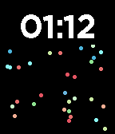
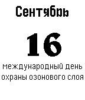

<!-- Generated by scripts/update_app_directory.py: do not edit by hand -->
[← All Pebble Developers](../developers.md)

# Dmitry Demenchuk

*2 watchfaces · Last updated 2026-10-11 · [About these lists](../about-app-lists.md)*

Links: [Pebble App Store](https://apps.repebble.com/apps/dev/dmitry-demenchuk_0f3801096b0ef6f37fa8ed87) · [GitHub (mrded)](https://github.com/mrded) · [Website (demenchuk.me)](http://demenchuk.me)

<button type="button" data-filter="all" aria-pressed="true">All 2</button><button type="button" data-filter="watchface" aria-pressed="false">Watchfaces 2</button><button type="button" data-filter="watchapp" aria-pressed="false" disabled>Apps 0</button>

<label class="dev-sort">Sort by <select><option value="updated">Recently updated</option><option value="released">Newest release</option><option value="title">A–Z</option></select></label>

<h2 class="app-name" id="app-9549cdc291824a589a78d81d"><a href="https://apps.repebble.com/9549cdc291824a589a78d81d">Particle Sim</a> v1.0.3</h2>
<a class="app-source" href="https://github.com/mrded/pb-particle-simulation" title="Source code" data-search-exclude>View source</a>

Watchface

Released 2026-05-01 Updated 2026-05-02

Runs on: Time 2, Time

A watchface that simulates colored particles responding to gravity in real time. WARNING: heavy computation, this will drain your battery. I&#x27;m looking for ways to optimise it.

<h2 class="app-name" id="app-55f920b3708b83194f000060"><a href="https://apps.repebble.com/55f920b3708b83194f000060">rulezDate</a> v1.1</h2>
<a class="app-source" href="https://github.com/mrded/rulezDate" title="Source code" data-search-exclude>View source</a>

Watchface

Released 2015-09-16 Updated 2015-10-20

Runs on: Time 2, Pebble 2 Duo, Pebble 2, Time, Classic

Календарь необычных праздников. Для работы необходима русская прошивка.

