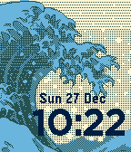

<!-- Generated by scripts/update_app_directory.py: do not edit by hand -->
[← All Pebble Developers](../developers.md)

# Dmitry Dodzin

*1 watchface · Last updated 2026-10-12 · [About these lists](../about-app-lists.md)*

Links: [Pebble App Store](https://apps.repebble.com/apps/dev/dmitry-dodzin_5501357517aaa97c2d0000c0) · [GitHub (DmitryDodzin)](https://github.com/DmitryDodzin)

<h2 class="app-name" id="app-56059ab092c56c56c3000089"><a href="https://apps.repebble.com/56059ab092c56c56c3000089">Wave</a> v0.9</h2>
<a class="app-source" href="https://github.com/DmitryDodzin/PebbleWave" title="Source code" data-search-exclude>View source</a>

Watchface

No licence Released 2015-09-25 Updated 2016-06-11

Runs on: Round 2, Time 2, Pebble 2 Duo, Pebble 2, Time Round, Time, Classic

A Simple Clock with a wave in the background

